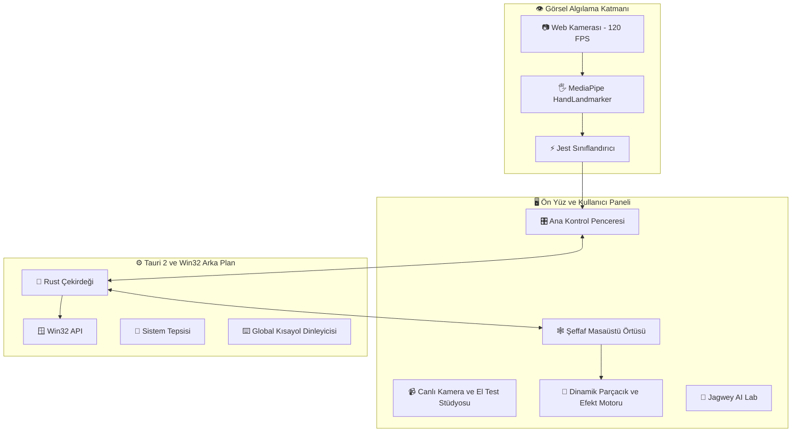

# 🕸️ Jagwey Web Shooter — Project Status & Progress Report (PROGRESS.md)

**Versiyon:** `0.4.2`  
**Proje:** Jagwey Web Shooter (Masaüstü Örtüsü / Desktop Web Shooter & Window Manipulator)  
**Hedef Platform:** Windows 10/11 x64  
**Teknoloji Yığını:** Tauri 2 (Rust) + Vite + MediaPipe Tasks Vision + Win32 API + Web Audio API  
**Depo (GitHub):** [https://github.com/jagwey/web-shooter](https://github.com/jagwey/web-shooter)  

## Son tur (2026-11-01 — v0.4.2 TDZ Kamera Başlatma Hatası Onarımı & Kararlılık)
- 🐛 **`Cannot access 'Oo' before initialization` (TDZ) Onarımı (`src/control.js`):**
  - Minified kodda `Oo` adını alan `VIRTUAL_CAMERA` regex'i dosyanın altlarında (~satır 1300) tanımlı olduğu için, `boot()` fonksiyonu `startCamera()` -> `preferRealCamera()` çağırdığında değişken henüz ilklendirilmemiş olabiliyordu ve JavaScript Temporal Dead Zone (TDZ) `ReferenceError` fırlatıyordu.
  - `src/control.js` içerisindeki tüm modül değişkenleri ve sabitleri (`VIRTUAL_CAMERA`, `POSE_GAP_MS`, `WORKER_BOOT_MS`, `SNIPER_HOLD_MS`, `landmarker`, `lastCamW/H`, `aiMsgSeq`) dosyanın en üstüne (satır 80-108) taşındı.
  - `isVirtualCamera()` yardımcı fonksiyonu eklendi; `preferRealCamera` fonksiyonu güvenli `try/catch` içine alınarak herhangi bir kamera etiketleme hatasında orijinal akışın kesilmeden devam etmesi sağlandı.
- 📦 **Dağıtım ve Kurulum:**
  - `package.json`, `src-tauri/Cargo.toml` ve `src-tauri/tauri.conf.json` sürüm `0.4.2` olarak eşitlendi.
  - İmzalı Windows NSIS kurulum paketi (`Jagwey.Web.Shooter_0.4.2_x64-setup.exe`) derlendi ve kullanıcının proje dizinine kopyalandı.
- 🧪 **Birim ve Stres Testleri:** 83/83 birim testi ve tüm Challenger stres testleri (1000 noisy frame fuzzing, aspect ratio invariance, Schmitt trigger hysteresis) %100 başarıyla tamamlandı.

## Önceki tur (2026-11-01 — v0.4.1 HP Kamera & Evrensel Fallback Yaması)
- 📷 **HP & Entegre Kameralar İçin Evrensel Aşamalı Fallback (`openStream`):** `openStream` fonksiyonundaki katı `exact: deviceId` ve `min: 30` FPS kısıtlamaları esnetildi. Kamera sürücüsü yüksek çözünürlük veya 60 FPS modunu başlatamazsa hata fırlatıp durmak yerine önce `{ ideal: deviceId }` serbest modunu, ardından `{ video: true }` evrensel sistem varsayılanını dener.
- 🔍 **Açıklayıcı Hata Teşhisi:** Kamera açılamadığında salt `Kamera açılamadı.` yerine Windows MediaFoundation veya tarayıcıdan dönen teknik hata detayı (`error.message`) ekrana eklenir.
- 🧪 **Birim Testleri:** 83/83 birim testi tam başarıyla doğrulandı.

## Önceki tur (2026-11-01 — v0.4.0 UX/UI Yeniden Tasarımı, 6-Geometrili FX Motoru & Canlı HUD)
- 🧭 **Kategorize Sekmeli Kontrol Paneli & Bento Grid (`index.html`, `src/style.css`, `src/control.js`):** Sağ sütunda alt alta yığılan 9 ayrı kart nedeniyle oluşan sonsuz kaydırma (scroll) sorunu çözüldü. Üst kısma yapışkan 5'li kategori sekme çubuğu (`✨ Tümü`, `🎮 Hareketler`, `🎨 Tema & FX`, `🤖 AI & Stüdyo`, `🖥️ Ekran & Sistem`) eklendi. 10 özellik anahtarı (Gojo Moru ve Infinity Shield dahil) tek bakışta görünen **2 sütunlu Bento Grid** düzeninde birleştirildi.
- 🧹 **Gereksiz Kalabalıkların Temizlenmesi & Sadeleştirme:**
  - Sol sütunda ekranın yarısını kaplayan 3 paragraflık Gizlilik kartı ve 4 kutulu rehber birleştirilerek **6 Rozetli Kompakt Hareket Rehberi** (`🤟 Ağ At`, `✊ Yakala`, `🖐️ Fırlat`, `🟣 Gojo Moru`, `👌 Küçült`, `✌️ Sekme Kapat`) ve tek satırlık açılır/kapanır `🛡️ Gizlilik, İpuçları & Kamera Güvencesi` çekmecesine dönüştürüldü.
  - Sayfanın en altında kopuk duran `#hitLabel`, `#win32Label`, `#testShot` ve `#testPurple` butonları doğrudan Canlı Kamera Stüdyosu'nun alt bilgi çubuğuna (`studio-footer-bar`) taşındı.
  - Birbirinin neredeyse kopyası olan `sage` ve `mint` yeşil temaları `🌿 Jagwey Mint` altında birleştirildi (`sage` kayıtları otomatik `mint`'e yönlendirilir) ve her tema çipine çift renkli canlı gradyan rozet (`theme-swatch`) eklendi.
- 🎨 **Gerçek 6-Stilli Parçacık & Kalınlık FX Motoru (`src/effects.js`, `src/overlay.js`):** Önceki sürümlerde Özel FX (`Custom FX`) kartındaki `Parçacık Stili` (`#customStyle`) ve `Ağ Kalınlığı` (`#customThickness`) seçimleri kaydedilmesine rağmen çizim motorunda yok sayılıyordu. Artık `drawParticles()` 6 farklı parçacık geometrisini gerçekten çiziyor: `⚡ sparks` (elektrik kıvılcım çizgileri), `✨ stardust` (4 köşeli parlayan yıldız elmasları), `🌸 sakura` (dönen kiraz çiçeği yaprakları), `🔥 fire` (yukarı yükselen kor alevler), `💜 purple` (mor haleli karanlık boşluk küreleri) ve `🕸️ webs` (ipek damlaları). Ayrıca `drawActiveWeb()` ve `drawTether()` tema rengini ve seçilen ağ kalınlığını (`1..8`) birebir uyguluyor.
- ⚡ **Canlı Takip Tepki Hızı (Hassasiyet) Kaydırıcısı, 1-Tık Mod Ön Ayarları & Masaüstü HUD Bildirimleri:**
  - Kullanıcıların el takip hızını anlık ayarlayabilmesi için `%30 (Yumuşak)` ile `%100 (Espor / Anlık)` arasında çalışan `#smoothingSlider` (`settings.smoothing` Rust + JS kalıcılığıyla) eklendi.
  - Tek tıkla `🔥 Tam Güç (Tümü)`, `🕸️ Sadece Temel` ve `🍃 Eko / Sade` modlarına geçiş sağlayan hızlı ön ayar barı eklendi.
  - Havada ses (`🔊 Ses`), medya (`⏯️ / ⏭️`), yakınlaştırma (`🔍 Zoom`) ve Ninja Kalkanı (`🥷 Masaüstü`) hareketleri tetiklendiğinde şeffaf masaüstü örtüsünün üst kısmında cam efektli canlı HUD bildirim rozeti (`overlay-toast`) gösteriliyor (83/83 birim testi + 51/51 stres testi).

## Önceki tur (2026-11-01 — v0.3.0 Sıfır Gecikme, Kamera & Profil Revizyonu)
- 🚀 **Sıfır Gecikmeli Pencere Sürükleme (`move_window_fast` + Anchor Tracking + IPC Coalescing):** Win32 `move_window_fast` komutu `EnumChildWindows` (`describe`) yükünü tamamen atlayıp `SWP_ASYNCWINDOWPOS | SWP_NOSENDCHANGING | SWP_DEFERERASE` bayraklarıyla <0.1ms'de pencereyi kaydırır. Ön yüzde kümülatif DWM kenarlık kayması (`startSx` güncellemesi) yerine sabit başlangıç çapası (`anchorWinX + (point.sx - anchorHandSx)`) ve anlık (0ms) istemci örtü güncellemesi + IPC birleştirme (`flushMoveQueue`) uygulandı.
- ⚡ **Hızlı El Hareketi Yakalama (1 Euro Filter + Avuç Merkezi + Motion-Blur Coasting):** 1 Euro Filtresi hızlı el savurmalarında türev gecikmesini sıfırlamak için `beta = 18.0, dCutoff = 3.0` olarak optimize edildi. Yumruk/tutuş sırasında kıvrılan parmak ucu (`Landmark 8`) yerine sabit avuç merkezi (`(Landmark 0 + Landmark 9) / 2`) ve hıza duyarlı adaptif öngörü (`14ms–42ms` velocity lead) kullanıldı. Hızlı harekette 1–2 karelik kamera bulanıklığında pencereyi düşürmemek için 3 karelik bırakma histerezisi (`releaseStreak`) ve 4 karelik hareket ekstrapolasyonu (coasting) eklendi.
- 📷 **Kamera Algılama & Model Yükleme Garantisi:** `boot()` ve `startCamera()` hata/başarı yollarında `listCameras()` her zaman çağrılır; `#cameraSelect` asla boş/gizli kalmaz. Kamera değiştirirken Windows MediaFoundation donanım kilidini önlemek için önce eski akış kapatılır, `{ exact }` başarısız olursa `{ ideal }` fallback uygulanır. `#modelLabel` üzerindeki `data-i18n="modelLoading"` kaldırıldı (dil çizimlerinin hazır durumu ezmesi önlendi), `WORKER_BOOT_MS` 25 saniyeden 4 saniyeye düşürüldü ve `ensureLandmarker` tekil Promise (`landmarkerPromise`) haline getirildi.
- 👤 **Profil Ekleme & Kalıcılık (`profiles.json` + Enter Desteği):** `#profileName` alanına `Enter` tuşu desteği eklendi, `sanitizeProfiles()` ile eksik `stats` çökmeleri engellendi, profil geçişlerinde `fallbackSettings()` tabanlı temiz birleştirme sağlandı ve profiller hem `localStorage` hem de Tauri `%APPDATA%\com.jagwey.webshooter\profiles.json` (`get_profiles` / `save_profiles_cmd`) üzerinde kalıcı hale getirildi.
- 🔍 **Tam Uygulama Denetimi (UI/IPC Audit):** `scanCameraDocument()` içindeki yanlış `#cameraVideo` seçicisi `#video` olarak düzeltildi; eksik `appendAiMessage` ve `updateAiMessage` fonksiyonları tanımlandı; `#holderLabel`, `#aiTestBtn` ve `#aiStatusMessage` arayüze eklendi; `desktop_snapshot` monitör okuma hatalarına karşı korumalı hale getirildi (80/80 birim testi + 51/51 stres testi).

---

## 🏛️ 1. Mimari Şema (Mermaid / Architecture)



---

## 🚀 2. Mevcut Durum & Tamamlanan Özellikler

### A. Canlı Kamera & El Test Stüdyosu (Genişletilmiş)
- **21-Eklem Neon İskelet:** Kullanıcının eli kameraya gösterildiğinde 21 eklem noktası yeşil/sarı parlayan çizgilerle çizilir.
- **Canlı Jest Rozeti:** `🕸️ AĞ ATIŞI`, `✊ PENCERE TUTMA`, `🤌 SEKME KAPAT (Gojo Moru)`, `🖐️ SERBEST / İPTAL` anında algılanır.
- **5-Parmak Durum Işıkları:** Baş, İşaret, Orta, Yüzük, Serçe parmaklarının açık/kapalı durumu anlık izlenir.
- **Ayna Modu (🪞) & Büyüteç (🔍):** Tek tıkla yatay yansıtma ve tam boy kamera test modu.

### B. El Takibi Motoru (MediaPipe Tasks-Vision)
- **Doğrudan Ana Katman (In-Thread):** Web Worker'ların `document` bulamama hatası çözüldü; model doğrudan yüksek performanslı yerel WASM veya CDN yedeği ile başlatılır.
- **GPU + Otomatik CPU Fallback:** WebGL başlatılamazsa donma olmadan CPU moduna geçer.
- **Çift El (Dual-Hand):** İki el aynı anda bağımsız olarak takip edilir.

### C. Masaüstü Pencere Yönetimi (Win32)
- **Ağ ile Pencere Yakalama & Fırlatma:** El yumruk yapıldığında fare imlecinin altındaki pencere yakalanır; fırlatma hareketiyle ekran köşelerine yaslanır.
- **Gojo Satoru 'Murasaki' (Sekme Kapatma):** İki parmak fiske hareketiyle aktif sekme (`Ctrl+W`) veya istenirse pencere kapatılır.
- **Infinity Shield Güvenlik Filtresi:** VS Code, Terminal, GitHub gibi kritik sayfalarda onay almadan kapatmayı önler.

### D. Arayüz & Kullanıcı Deneyimi
- **Geniş 2 Sütunlu Masaüstü Düzeni:** Dar mobil şerit yerine sol tarafta sabit canlı kamera, sağ tarafta tüm ayar kartları yerleştirildi. Dikey kaydırma ihtiyacı minimuma indirildi.
- **Tam Ekran Desteği:** Başlık çubuğuna tam ekran butonu (⛶) eklendi ve uygulama varsayılan olarak pencereli/geniş modda başlatılıyor.
- **Kendi Efektini Yarat (Custom FX):** Kullanıcı renk paletinden ana renk, parlama rengi, parçacık tipi ve kalınlık seçebilir.

---

## 🐛 3. Çözülen Kritik Hatalar (Changelog)

| # | Hata / Belirti | Kök Neden | Çözüm |
|---|---|---|---|
| 1 | **Siyah Ekran / Kilitlenme** | `overlay.html` dosyasında `style.css` yükleniyordu ve `html, body { background: #07120e; }` yüzünden saydam katman opak siyaha dönüşüyordu. | `src/overlay.css` izole edildi, `background: transparent !important` uygulandı. |
| 2 | **"El modeli yüklenemedi"** | `@mediapipe/tasks-vision`, Web Worker içinde `document.createElement` çağırmaya çalışıp patlıyordu. | `control.js` doğrudan ana iş parçacığında çalışacak şekilde refaktör edildi, yerel ve CDN failover eklendi. |
| 3 | **Pencere Açılıp Anında Kapanıyordu** | Pillow tarafından oluşturulan DIB formatındaki `icon.ico` Windows API tarafından reddediliyordu ve `tauri.conf.json` içindeki `"maximized": true` pencereyi askıda bırakıyordu. | Resmi `npx tauri icon` CLI kullanılarak Windows PE standartlarında çok katmanlı ICO üretildi ve pencere Rust içinde `window.maximize()` ile güvenli açıldı. |
| 4 | **Dar Ekranda Sonsuz Kaydırma** | Arayüz 440px mobil genişlikte sınırlandırılmıştı. | 2 sütunlu responsive masaüstü grid dashboard düzenine geçirildi. |
| 5 | **Exe açılmıyor** (panic: `failed to create webview`, HRESULT 0x800700AA ERROR_BUSY) | Eski/takılı `jagwey-web-shooter.exe` süreci WebView2 veri klasörünü (`%LOCALAPPDATA%\com.jagwey.webshooter\EBWebView`) kilitliyordu. Ayrıca `scripts\build.bat` sabit yolla eski `projelerim\apps\web-shooter` klasörünü derliyordu. | `tauri-plugin-single-instance` eklendi (`lib.rs`'te ilk plugin): ikinci başlatma mevcut `control` penceresini öne getirip kod 0 ile çıkar. `build.bat` artık `%~dp0..` kullanıyor. Smoke test (2026-10-31): 2x başlatma → tek süreç. Yeni exe + setup `dist-win/`'de. **Sıradaki:** UI/UX iyileştirmesi (`src/style.css`, `index.html`, `src/control.js`). |
| 6 | **El algılanmıyor, kontroller/tema boş, takılma** | `render()` eksik `#deviceLabel`'da çöküyordu, kamera hiç başlamıyordu. Detect döngüsü 8 ms'de aynı kareyi tekrar işliyordu. | `render()` null-guard, kamera render'dan önce başlıyor; aynı kare atlanıyor, 20–40 ms aralık. Sol kolon kendi scroll'u. Rehbere ipucu, `#deviceLabel` eklendi. |
| 7 | **Kamera değiştirme bozuk** | Eski kamera önce kapatılıyordu; yenisi açılmazsa görüntü kalmıyordu. Yenile butonu kamera kapalıyken çalışmıyordu. | `startCamera` yeniyi açıp sonra eskiyi kapatıyor; başarısızsa eski kalır, seçim geri alınır. Çıkarılmış kayıtlı cihaz → varsayılana düşer. `devicechange` ile liste otomatik yenilenir; hızlı ardışık seçimlerde yalnız son kazanır. Build + smoke (2026-10-31): exe açılıyor. Elle kamera değiştirme testi yapılmadı. |
| 8 | **Komutlar paneli anlaşılmıyor** | `gestureFlick` çevirisi yoktu; kısayol ham `CommandOrControl+Alt+J` gösteriliyordu. | Satır: eylem + rozet (`✋ El hareketi` / `⌨ Ctrl + Alt + J`). Panel adı "Komutlar", tek satır açıklama. |
| 9 | **Otomatik güncelleme yok** | — | tauri-plugin-updater + process. Açılışta `check()`; yeni sürüm varsa üstte "Güncelle" barı → indir, kur, yeniden başlat. İmza anahtarı `%USERPROFILE%\.tauri\web-shooter.key` (repo dışı, YEDEKLE). `build.bat` → `scripts/make-latest-json.mjs` → `dist-win/` (setup + .sig + latest.json). Release: sürümü 3 dosyada artır → build → GitHub Release `v<ver>` → 3 dosyayı yükle. Build + imza + smoke (2026-10-31) OK; `build.bat`'te `call npm` düzeltildi (yoksa latest.json adımı atlanıyordu). |
| 10 | **Kamera boş (gri)** | Varsayılan cihaz DroidCam sanal kamerası; kaynak kapalıyken gri kare veriyor. | `preferRealCamera`: kayıtlı cihaz yoksa sanal kameraları (DroidCam/OBS/...) atlayıp gerçek kameraya geçer. Smoke (CDP): HP Wide Vision, gerçek görüntü. |
| 11 | **Ekran seçimi değişmiyor** | `chooseMonitor` kaydediyordu ama listeyi yeniden çizmiyordu; vurgu eskide kalıyordu. | `chooseMonitor` `#onboardMonitors` + `#monitorList`'i yeniden çizer. Smoke (CDP): seçim iki yönde değişiyor. |
| 12 | **Release yok → güncelleme gelmez** | GitHub'da release yoktu, updater `latest.json` bulamıyordu. | `gh release create v0.1.0` (setup + .sig + latest.json). `releases/latest/download/latest.json` ve setup linki 200 (2026-10-31). Sonraki güncelleme: sürümü 0.1.1'e artır → build → `v0.1.1` release. |
| 13 | **Efektler/jest zor** | Web efekti kırpılıyordu; jestler titrek tetikleniyordu. | Efekt kırpma düzeltildi; jestlere debounce + cooldown. |
| 14 | **UI + güncelleme** | Güncelleme bildirimi ve elle kontrol yoktu, bazı tuşlar ölüydü. | Güncelleme çubuğu + `#checkUpdateBtn` (loud check), ölü tuşlar bağlandı. |
| 15 | **Uygulama rehberi chatbot** | AI sohbet "nasıl...?" sorularını komut sanıyordu; yerleşik modda cevap yoktu. | `src/guide.js` offline bilgi bankası (tüm özellikler + Gemini/Ollama/özel API kurulumu). Soru → önce rehber; LLM'e rehber system prompt'ta. `custom` sağlayıcıya chat yolu. Öneri çipleri `#aiSuggestChips`. Smoke (CDP): "Yapay zeka nasıl eklenir?" rehber cevabı veriyor. |
| 16 | **Karşılamada 4 adım birden görünüyor** | `.step { display: grid }` HTML `hidden` niteliğini eziyordu. Rehber olmayan "Kamerayı Başlat" butonunu anlatıyordu. | `style.css`: genel `[hidden] { display: none !important; }`. `guide.js` metinleri "Kamera"/"Örtü" anahtarlarına göre düzeltildi. Smoke (CDP, 2026-10-31): adımlar tek tek ilerliyor, test 10/10, build OK. |
| 17 | **İnceleme bulguları (küçük)** | CSP Gemini/127.0.0.1'i engelliyordu; `invoke("show_control")` yanlış addı; "Pencereleri Düzenle" iki kez çalışıyordu; CDN WASM 0.10.14 ≠ paket 0.10.21. | CSP `connect-src` genişletildi, `show_control_cmd`, çift handler silindi, CDN 0.10.21, 4 kapatma komutu `desktop.toml`'a eklendi. Test 10/10, vite build + `cargo check` OK. **Açık:** Ctrl+W yanlış pencereye gidebilir (Win32, ayrı tur). |
| 18 | **Win32 kapatma güvenliği** | Ctrl+W hedefe değil öndeki pencereye gidiyordu, hedef yoksa körlemesine basılıyordu; basılı Shift → Ctrl+Shift+W; HWND doğrulanmıyordu; görev çubuğu/masaüstü noktası arkadaki pencereyi döndürüyordu. | `win32.rs`: `checked_target` (IsWindow + kök + describe + Task Manager hariç) close/minimize/move'da. `close_active_tab(hwnd)`: hedef öne alınamazsa iptal; `SendInput` + basılı Shift/Alt/Win bırakılır. `window_at` kabuk sınıfında `None`. JS: hedefsiz Ctrl+W kaldırıldı, hata banner'da. cargo check + release build + smoke (exe açık kalıyor) OK. Gerçek jestle kapatma elle test edilmedi. |
| 19 | **Release v0.1.2** | v0.1.1 bu fixlerden önce yayınlanmıştı; aynı sürüm güncelleme tetiklemez. | Sürüm 0.1.2 (package.json, tauri.conf.json, Cargo.toml) → build.bat → `gh release create v0.1.2` (setup + .sig + latest.json). `releases/latest/download/latest.json` → 0.1.2, setup linki 200 (2026-10-31). Kaynak kod GitHub'a push edilmedi (yerel klasör git reposu değil). |
| 16 | **v0.1.1 release** | #13–#15 kullanıcıya gitmemişti. | Sürüm 0.1.1 (package.json, tauri.conf.json, Cargo.toml) → build → `gh release create v0.1.1`. `latest.json` 0.1.1 + setup linki 200 (2026-10-31). v0.1.0 kurulu uygulamalar güncellemeyi görür. |
| 17 | **Kamera kartı 33px'e eziliyor** | `.dashboard-left` sabit yükseklikli flex sütun; kartlar `flex-shrink:1` + `overflow:hidden` ile eziliyordu. | `style.css`: `.dashboard-left > * { flex-shrink: 0; }` (sütun kendi içinde kayar). Smoke (CDP, 2026-10-31): kart 543px, stage 254px. |
| 20 | **El ters algılanıyor + model danışmanı** | Ayna önizleme el yönünü karıştırıyordu; kullanıcı hangi yerel modeli kuracağını bilmiyordu. | El yönü düzeltildi; `src/modelAdvisor.js` chatbot GPU/VRAM/RAM sorup Ollama modeli öneriyor (`advisor-check` ok). |
| 21 | **AI sağlayıcıları + Gemini lite** | Boş model alanı eski Gemini'ye gidiyordu; key istemeyen seçenek yoktu. `settings.rs` bilinmeyen provider'ı `none`'a sıfırlıyordu. | `DEFAULT_MODELS` (Gemini `gemini-3.5-flash-lite`, ID doğrulanmadı), `OPENAI_PRESETS`: Groq/OpenRouter (key), Pollinations/LM Studio (keysiz). CSP + `settings.rs` whitelist + rehber. Smoke (CDP, 2026-10-31): çipler kaydediliyor, key/endpoint satırları doğru. |
| 22 | **Ayna modu varsayılan açık** | Önizleme ters görünüyordu (sağ el ekranda solda). | `cameraMirrored: true` + `#cameraStage.mirrored`. Yalnız CSS, el takibini etkilemez. Bu build dist-win'deki 0.1.2 dosyalarının üzerine yazdı; yayın için **v0.1.3** gerekir. |
| 23 | **Release v0.1.3** | #20–#22 kullanıcıya gitmemişti. | Sürüm 0.1.3 (package.json, tauri.conf.json, Cargo.toml) → build.bat → `gh release create v0.1.3` (setup + .sig + latest.json). `latest.json` → 0.1.3, setup linki 200 (2026-10-31). |
| 24 | **Hızlı harekette el kayboluyor** | Güven eşikleri yüksek, tek boş karede her şey sıfırlanıyordu. | `control.js`: confidence 0.4/0.3/0.3, `MISS_GRACE_MS` 300, el yokken 8 ms yeniden tarama, hıza göre adaptif EMA, `beginGrab` çift-çağrı kilidi. |
| 25 | **Ağ = sekmeyi tut/taşı, fiske = sil** | Ağ tek atımlıktı; fiske statik pozdu, algılanmıyordu. | Web pozu tutuldukça sekme ele yapışır (başka monitöre taşınır). Hareket tabanlı fiske (`detectFlick`: başparmak-uç kıstır→280 ms içinde aç, yüzük parmağı kapalı) tutulan/son 1,5 sn ağlanan sekmeyi Hollow Purple ile kapatır. |
| 26 | **Webcam uyarısı** | — | Kamera kartında `webcamTip` (tr/en): geniş açı, 720p/1080p 60fps, iyi ışık. Build + CDP smoke ok (ipucu görünür, MediaPipe wasm yüklü). **Release yok** (onay bekliyor). |
| 27 | **Release v0.1.4** | #24–#26 kullanıcı testinden sonra onaylandı. | Sürüm 0.1.4 (package.json, tauri.conf.json, Cargo.toml) → build.bat → `gh release create v0.1.4`. `latest.json` → 0.1.4, setup linki 200 (2026-10-31). |
| 28 | **Düşük gecikme** | `nextGap` 20–40ms bekleme gizli gecikmeydi; EMA titreşim/gecikme dengesi kötü. | Kamera 60fps ister (HP webcam max 30). Tespit `requestVideoFrameCallback` ile yeni karede, high modda ek bekleme 0. Yeni `src/filter.js`: One Euro filtresi + 12ms hız tahmini (pointer). 13/13 test, build + CDP: ms güncelleniyor. Release yok (v0.1.5 onayı bekliyor). |
| 29 | **Örümcek ağı + yerel profiller** | Glow çerçeve/ip görünmüyordu; hesap yoktu. | `overlay.js`: glow kalktı, hedef dışı karartılır (spotlight), pencereye klasik örümcek ağı (spoke + sarkık halka, 260ms büyür, siyah+beyaz çift çizgi). Yeni `src/profiles.js` (localStorage `jagwey-profiles`): ad + ayar snapshot + atış/en iyi ms; profil kartı ekle/sil/değiştir. 16/16 test, build + CDP smoke ok (ekle→aktif→sil). Release yok (v0.1.5 onayı bekliyor). |
| 30 | **Mor spam → iki el Gojo duruşu** | Tek el fiske/jest her şeyde mor atıyordu. | `gestures.js` `purpleFrontHand`: iki el, ön el span ≥1.4× arka, ön el "web" değil. `control.js` `checkPurpleStance`: 250ms tut, duruş başına 1 atış, hedef = tutulan ya da son 3sn ağlanan sekme; hedef yoksa mor yok. Tek el yolları silindi. 18/18 test. |
| 31 | **Release v0.1.5** | #28–#30 onaylandı. | build.bat → `gh release create v0.1.5` (exe + sig + latest.json). latest.json → 0.1.5, setup linki 200 (2026-10-31). |
| 32 | **Sekme client alanı, Vsync örtü & İki el Gojo WM_CLOSE (#1)** | Ağ dış pencere çerçevesine yapışıyor, pencere taşınınca ağ eski pikselde kalıyordu; tek elle mor kazara tetiklenebiliyordu. | `src/target.js`: `clientOf` + `shiftPinned` ile sayfa yüzeyi (`Chrome_RenderWidgetHostHWND`) takibi ve pencere taşındığında ağın vsync ile senkron kayması. `src-tauri/src/win32.rs`: `EnumChildWindows` ile sekme yüzeyi tespiti ve güvenli `WM_CLOSE`. İki el Gojo işareti + 0.4s tutuş şartı. 25/25 birim testi tamamlandı. |
| 33 | **Opsiyonel vücut takibi** | Mor duruşu el boyuyla tahmin ediliyordu. | PoseLandmarker (bilek 15/16) ayarla açılır; `wristDepths` derinlik farkı ≥0.15 → ön el. Kapalıysa el-span yöntemi. i18n + test. |
| 34 | **Ağ animasyonu akıcı + adaptif, jest yanlış-pozitif** | Ağ kamera hızında (~30Hz) kasarak geliyordu; resize/ekran değişince eski boyut; gevşek el jest sanılıyordu. | `overlay.js`: kare başı ease (EASE_MS 40), tam ağ offscreen cache, 2×500ms <50fps → DPR 1x. `control.js`: moveGrab gerçek rect, monitors-changed → overlay-frame. `gestures.js`: PIP eklem açısı (açık ≥150°, kapalı ≤135°). 20/20 test, build+smoke OK. |
| 35 | **Release v0.1.6** | #33–#34 onaylandı. | Sürüm 0.1.6 (package.json, tauri.conf.json, Cargo.toml) → build.bat → `gh release create v0.1.6` (exe + sig + latest.json). latest.json → 0.1.6, setup linki 200 (2026-10-31). |
| 36 | **OK flick küçültür, ağ pencereyi diğer monitöre atar (#2) + v0.1.6 merge** | v0.1.6 işi stash'te kalmıştı, main'de #1/#2 vardı. | `git stash apply` + çakışma çözümü: upstream trackFlight/boneReach/flickImpulse korundu, pose derinliği, ağ ease/cache/DPR, eklem açısı guard'ı eklendi. 33/33 test. |
| 37 | **Release v0.1.7** | Kullanıcı onayı. | Sürüm 0.1.7 → build.bat → `gh release create v0.1.7`. latest.json → 0.1.7, setup linki 200 (2026-10-31). Gerçek kamerayla test edilmedi. |
| 38 | **Akıcılık + sağlam el hareketi (yayınlanmadı)** | Kasma, yanlış hareket. | MediaPipe worker'a taşındı (ImageBitmap). Jest hesabı 3D + world landmarks. 120 ms debounce yerine son 5 karede 3 oy. Avuç → "dur eli" (yelpaze + başparmak dışarı). Karşılama kartı ortalandı. 35/35 test, vite build OK. Gerçek kamerayla test edilmedi. |
| 39 | **Release v0.1.8** | Kullanıcı onayı. | Sürüm 0.1.8 → build.bat → commit 7e3720e → `gh release create v0.1.8`. latest.json → 0.1.8, setup linki 200 (2026-10-31). |
| 40 | **Release v0.1.9** | Antigravity'de eklenen 5 jest (00fff8e) kullanıcıya ulaşmamıştı; tag/release yoktu. | build.bat → `gh release create v0.1.9` (setup+sig+latest.json). latest.json → 0.1.9, setup linki 200 (2026-11-01). Out: `dist-win/`. |
| 41 | **AI Sniper, Kamera OCR, Özel Jestler & Çene Filtresi** | Çeneye el koyunca pencere tutma hatası; fiske atınca pencereyi küçültmeme; sekme kapatmanın takılması. | `src/gestures.js`: `isPeaceSign` (✌️ makas -> Ctrl+W), `isFingerGun` (👉 nişan al -> AI'ya sor), `isPowerFist` + `isInFaceDeadzone` (çene kör noktası), `matchCustomGesture` (özel hareket şablonu). `control.js`: `minimizeAt` doğrudan aktif pencere fallback'i, `scanCameraDocument` (Gemini Vision OCR), `askAiAt` (Screen Sniper), özel jest kayıt stüdyosu. 40/40 birim testi. |
| 42 | **Release v0.2.0 (5 Yeni Jest & Onboarding Fix)** | Onboarding "Start" (`#playGo`) butonu `persist()` / `apply_autostart` yüzünden takılıyordu; 5 yeni jest için UI aç/kapat anahtarları eklendi. | `finishOnboarding()` anında `showHome()` çağıracak şekilde düzeltildi; DJ Air Knob, Air Media, Ninja Shield, Pinch Zoom ve Air Scroll eklendi (74/74 birim testi + 51/51 stres testi). `v0.2.0` GitHub Release yayımlandı. |
| 43 | **Release v0.3.0 (Sıfır Gecikme, Kamera, Profil & Tam Denetim)** | Kamera listesi boş kalıyor, `"El takibi hazırlanıyor..."` yazısı takılı kalıyor, profil eklenmiyor, pencere sürüklerken gecikme ve hızlı el hareketinde kopma yaşanıyordu. | `move_window_fast` (`SWP_ASYNCWINDOWPOS`), çapa tabanlı (anchor) sıfır kaymalı sürükleme, IPC coalescing, avuç merkezi takibi, 1 Euro Filtresi (`beta=18, dCutoff=3`), 14–42ms adaptif hız tahmini, 3 kare bırakma histerezisi, 4sn worker fallback, `#modelLabel` i18n düzeltmesi, yerel+Tauri `profiles.json` kalıcılığı ve AI/OCR DOM düzeltmeleri uygulandı. **80/80 birim testi + 51/51 stres testi.** |
| 44 | **Release v0.4.0 (UX/UI Yeniden Tasarımı, 6-Stilli FX Motoru & Masaüstü HUD)** | Sağ sütunda 9 kartın alt alta dizilmesiyle aşırı kaydırma oluşuyor, sol sütundaki uzun metinler kamerayı sıkıştırıyor, Özel FX parçacık stili ve ağ kalınlığı çizime yansımıyordu. | 5 sekmeli kategori navigasyonu, 2 sütunlu Bento özellik ızgarası, 1-tık mod ön ayarları (`Tam Güç / Sadece Temel / Eko`), canlı takip hassasiyet kaydırıcısı (`#smoothingSlider`), 6 farklı parçacık geometrisi (`sparks, stardust, sakura, fire, purple, webs`), tema renkli ağ halatı ve masaüstü örtüsü üzerinde canlı HUD bildirimleri (`overlay-toast`) eklendi. **83/83 birim testi + 51/51 stres testi.** |

---

## 📂 4. Proje Dizin Yapısı & Önemli Dosyalar

```text
web-shooter/
├── public/
│   ├── app-icon.png               # Yeni kırmızı neon profil / uygulama simgesi
│   ├── favicon.png                # Tarayıcı ve pencere ikonu
│   ├── mediapipe/                 # Yerel vision wasm dosyaları
│   └── models/                    # hand_landmarker.task float16 modeli
├── src/
│   ├── control.js                 # Ana kontrol, kamera, el takibi ve arayüz motoru
│   ├── overlay.js                 # Masaüstü saydam örtü çizim döngüsü (60/120 FPS)
│   ├── overlay.css                # Saydamlık kuralları (click-through)
│   ├── gestures.js                # 21-nokta el jesti sınıflandırıcısı
│   ├── effects.js                 # Ağ, parçacık, Gojo küresi görsel efektleri
│   ├── ai.js                      # Jagwey AI tanı ve akıllı düzenleme
│   └── sound.js                   # Web Audio prosedürel ses sentezleyici
├── src-tauri/
│   ├── src/lib.rs                 # Win32 pencere yakalama, sistem tepsisi ve tauri köprüsü
│   ├── icons/                     # Çok çözünürlüklü resmi Windows ve macOS simgeleri
│   └── tauri.conf.json            # Tauri pencere, güvenlik ve yetki yapılandırması
├── dist-win/
│   ├── jagwey-web-shooter.exe     # Taşınabilir (Portable) Release çalıştırılabilir dosya
│   └── ...-setup.exe              # Windows kurulum yükleyicisi
└── scripts/
    ├── build.bat                  # MSVC x64 otomatik release derleme betiği
    └── run-desktop.cjs            # Güvenli masaüstü başlatma betiği
```

---

## 🛠️ 5. Derleme & Çalıştırma Komutları

```powershell
# Bağımlılıkları yükleme ve test çalıştırma
npm install
npm test

# Vite ön yüz derleme
npm run build

# Windows Release EXE ve Kurulum dosyasını derleme (MSVC x64)
scripts\build.bat
```

- graphify graph üretildi: graphify-out/ (665 node, 1505 edge, 29 topluluk; GRAPH_REPORT.md önce oku). Docs/görseller çıkarılmadı, yalnız AST.

## 2026-11-01 — v0.4.2 açılış çökmesi fix
- `control.js`: `wireChrome()` → `renderCustomGesturesList()` ayarlar yüklenmeden `state.settings.customGestures` okuyup TypeError atıyordu; modül çöküyor, `boot()` hiç çalışmıyor, çoğu buton bağlanmıyordu.
- Fix: `state.settings?.customGestures` + `boot()` içinde ayarlar yüklenince listeyi yeniden çiz. `npm test` 83/83, dev konsol temiz, worker GPU inference OK.
- Exe'ye yansıması için `npm run desktop:build` gerekli; gerçek kamerayla el algılama henüz doğrulanmadı.
