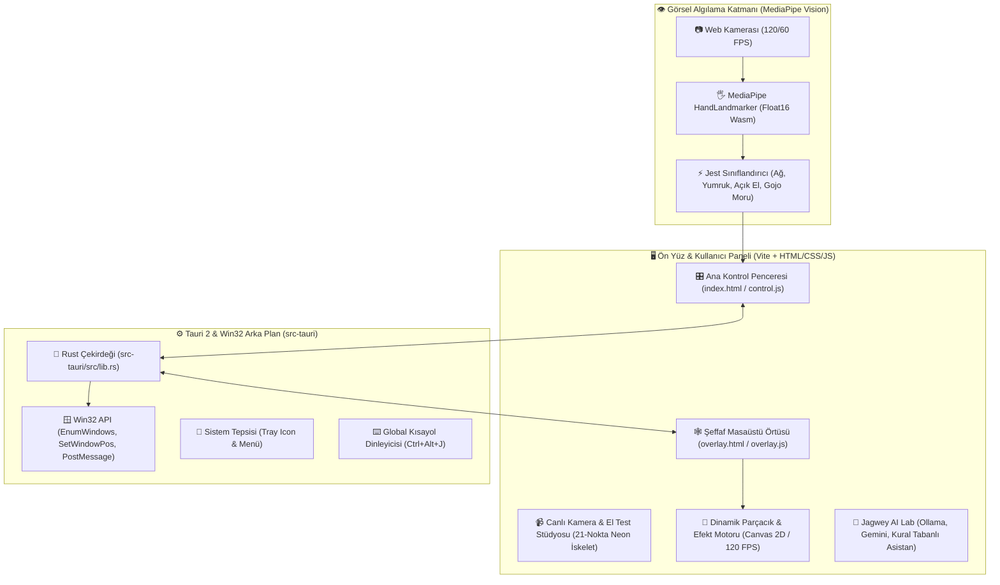

# 🕸️ Jagwey Web Shooter — Project Status & Progress Report (PROGRESS.md)

**Versiyon:** `0.1.0`  
**Proje:** Jagwey Web Shooter (Masaüstü Örtüsü / Desktop Web Shooter & Window Manipulator)  
**Hedef Platform:** Windows 10/11 x64  
**Teknoloji Yığını:** Tauri 2 (Rust) + Vite + MediaPipe Tasks Vision + Win32 API + Web Audio API  
**Depo (GitHub):** [https://github.com/jagwey/web-shooter](https://github.com/jagwey/web-shooter)  

---

## 🏛️ 1. Mimari Şema (Mermaid / Architecture)



---

## 🚀 2. Mevcut Durum & Tamamlanan Özellikler

### A. Canlı Kamera & El Test Stüdyosu (Genişletilmiş)
- **21-Eklem Neon İskelet:** Kullanıcının eli kameraya gösterildiğinde 21 eklem noktası yeşil/sarı parlayan çizgilerle çizilir.
- **Canlı Jest Rozeti:** `🕸️ AĞ ATIŞI`, `✊ PENCERE TUTMA`, `🤌 SEKME KAPAT (Gojo Moru)`, `🖐️ SERBEST / İPTAL` anında algılanır.
- **5-Parmak Durum Işıkları:** Baş, İşaret, Orta, Yüzük, Serçe parmaklarının açık/kapalı durumu anlık izlenir.
- **Ayna Modu (🪞) & Büyüteç (🔍):** Tek tıkla yatay yansıtma ve tam boy kamera test modu.

### B. El Takibi Motoru (MediaPipe Tasks-Vision)
- **Doğrudan Ana Katman (In-Thread):** Web Worker'ların `document` bulamama hatası çözüldü; model doğrudan yüksek performanslı yerel WASM veya CDN yedeği ile başlatılır.
- **GPU + Otomatik CPU Fallback:** WebGL başlatılamazsa donma olmadan CPU moduna geçer.
- **Çift El (Dual-Hand):** İki el aynı anda bağımsız olarak takip edilir.

### C. Masaüstü Pencere Yönetimi (Win32)
- **Ağ ile Pencere Yakalama & Fırlatma:** El yumruk yapıldığında fare imlecinin altındaki pencere yakalanır; fırlatma hareketiyle ekran köşelerine yaslanır.
- **Gojo Satoru 'Murasaki' (Sekme Kapatma):** İki parmak fiske hareketiyle aktif sekme (`Ctrl+W`) veya istenirse pencere kapatılır.
- **Infinity Shield Güvenlik Filtresi:** VS Code, Terminal, GitHub gibi kritik sayfalarda onay almadan kapatmayı önler.

### D. Arayüz & Kullanıcı Deneyimi
- **Geniş 2 Sütunlu Masaüstü Düzeni:** Dar mobil şerit yerine sol tarafta sabit canlı kamera, sağ tarafta tüm ayar kartları yerleştirildi. Dikey kaydırma ihtiyacı minimuma indirildi.
- **Tam Ekran Desteği:** Başlık çubuğuna tam ekran butonu (⛶) eklendi ve uygulama varsayılan olarak pencereli/geniş modda başlatılıyor.
- **Kendi Efektini Yarat (Custom FX):** Kullanıcı renk paletinden ana renk, parlama rengi, parçacık tipi ve kalınlık seçebilir.

---

## 🐛 3. Çözülen Kritik Hatalar (Changelog)

| # | Hata / Belirti | Kök Neden | Çözüm |
|---|---|---|---|
| 1 | **Siyah Ekran / Kilitlenme** | `overlay.html` dosyasında `style.css` yükleniyordu ve `html, body { background: #07120e; }` yüzünden saydam katman opak siyaha dönüşüyordu. | `src/overlay.css` izole edildi, `background: transparent !important` uygulandı. |
| 2 | **"El modeli yüklenemedi"** | `@mediapipe/tasks-vision`, Web Worker içinde `document.createElement` çağırmaya çalışıp patlıyordu. | `control.js` doğrudan ana iş parçacığında çalışacak şekilde refaktör edildi, yerel ve CDN failover eklendi. |
| 3 | **Pencere Açılıp Anında Kapanıyordu** | Pillow tarafından oluşturulan DIB formatındaki `icon.ico` Windows API tarafından reddediliyordu ve `tauri.conf.json` içindeki `"maximized": true` pencereyi askıda bırakıyordu. | Resmi `npx tauri icon` CLI kullanılarak Windows PE standartlarında çok katmanlı ICO üretildi ve pencere Rust içinde `window.maximize()` ile güvenli açıldı. |
| 4 | **Dar Ekranda Sonsuz Kaydırma** | Arayüz 440px mobil genişlikte sınırlandırılmıştı. | 2 sütunlu responsive masaüstü grid dashboard düzenine geçirildi. |

---

## 📂 4. Proje Dizin Yapısı & Önemli Dosyalar

```text
web-shooter/
├── public/
│   ├── app-icon.png               # Yeni kırmızı neon profil / uygulama simgesi
│   ├── favicon.png                # Tarayıcı ve pencere ikonu
│   ├── mediapipe/                 # Yerel vision wasm dosyaları
│   └── models/                    # hand_landmarker.task float16 modeli
├── src/
│   ├── control.js                 # Ana kontrol, kamera, el takibi ve arayüz motoru
│   ├── overlay.js                 # Masaüstü saydam örtü çizim döngüsü (60/120 FPS)
│   ├── overlay.css                # Saydamlık kuralları (click-through)
│   ├── gestures.js                # 21-nokta el jesti sınıflandırıcısı
│   ├── effects.js                 # Ağ, parçacık, Gojo küresi görsel efektleri
│   ├── ai.js                      # Jagwey AI tanı ve akıllı düzenleme
│   └── sound.js                   # Web Audio prosedürel ses sentezleyici
├── src-tauri/
│   ├── src/lib.rs                 # Win32 pencere yakalama, sistem tepsisi ve tauri köprüsü
│   ├── icons/                     # Çok çözünürlüklü resmi Windows ve macOS simgeleri
│   └── tauri.conf.json            # Tauri pencere, güvenlik ve yetki yapılandırması
├── dist-win/
│   ├── jagwey-web-shooter.exe     # Taşınabilir (Portable) Release çalıştırılabilir dosya
│   └── ...-setup.exe              # Windows kurulum yükleyicisi
└── scripts/
    ├── build.bat                  # MSVC x64 otomatik release derleme betiği
    └── run-desktop.cjs            # Güvenli masaüstü başlatma betiği
```

---

## 🛠️ 5. Derleme & Çalıştırma Komutları

```powershell
# Bağımlılıkları yükleme ve test çalıştırma
npm install
npm test

# Vite ön yüz derleme
npm run build

# Windows Release EXE ve Kurulum dosyasını derleme (MSVC x64)
scripts\build.bat
```
