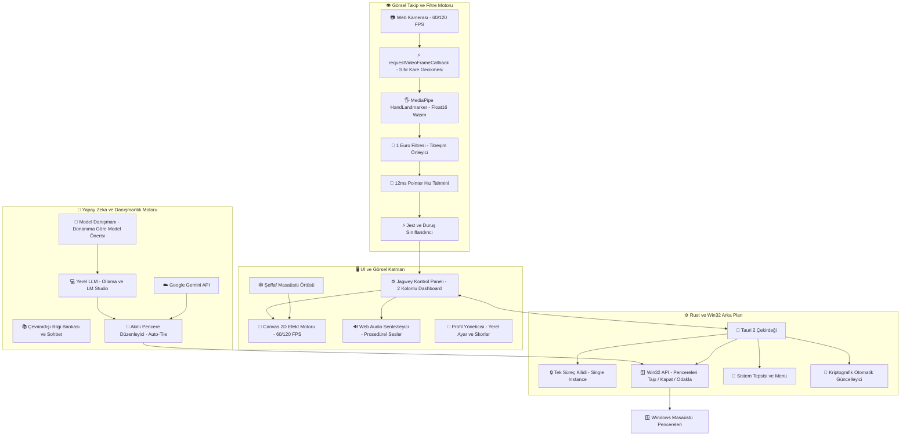
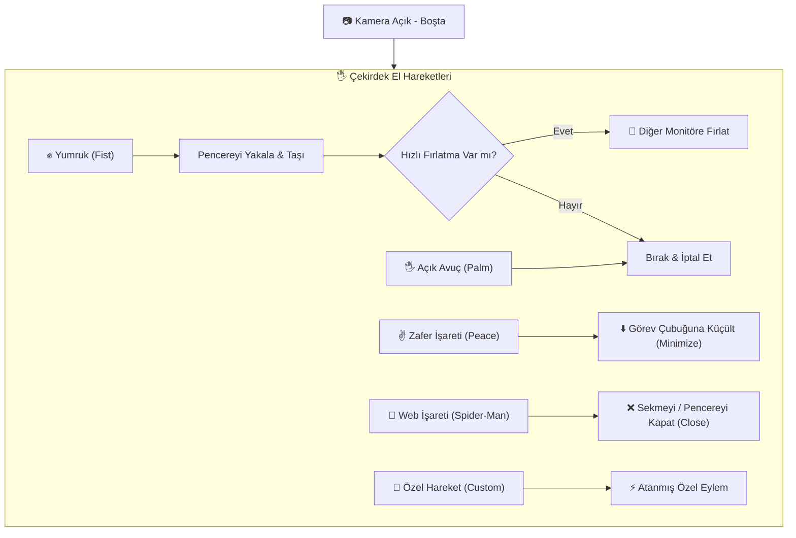

# Jagwey Web Shooter 🕸️⚡🟣

<p align="center">
  
</p>

<div align="center">


**Windows Masaüstü El Takibi ve Akıllı Pencere Yönetim Katmanı**  
*Desktop Overlay · Real-Time Hand Tracking · Window Fling & Drag · Quick Tab Closer · Soft Modern Glass UI*

Geliştirici: **Jagwey** (Osman) · GitHub: [github.com/jagwey/web-shooter](https://github.com/jagwey/web-shooter)

</div>

---

## 🏛️ Mimari Şema / System Architecture



---

## 🎮 Jest ve Eylem Akış Şeması / Gesture & Action Workflow



---

## ⏳ Sürüm Gelişim Zaman Çizelgesi / Evolution Timeline

```mermaid
flowchart TD
    v010["<b>v0.1.0 — Temel Mimari</b><br/>Tauri 2 + Rust + Win32 saydam örtü<br/>Web Audio sentezleyici ve Float16 MediaPipe"]
    v011["<b>v0.1.1 — Stüdyo ve Gojo Moru</b><br/>21-nokta neon iskelet kamerası<br/>Hollow Purple sekme kapatıcı ve 2 kolonlu UI"]
    v012["<b>v0.1.2 — Güvenlik ve Kararlılık</b><br/>Tek süreç kilidi (single-instance)<br/>Win32 checked_target ve güvenli kamera geçişi"]
    v013["<b>v0.1.3 — AI ve Akıllı Rehber</b><br/>src/guide.js çevrimdışı bilgi bankası<br/>Model danışmanı ve GitHub auto-updater"]
    v014["<b>v0.1.4 — Dinamik Fiske ve Ağ Tutuşu</b><br/>detectFlick dinamik parmak hareketi<br/>Ağ ile sürekli sekme taşıma ve duruş tespiti"]
    v015["<b>v0.1.5 — Ultra Hız ve Gerçekçi Ağ</b><br/>requestVideoFrameCallback + 1 Euro filtresi<br/>12ms hız tahmini, sarkık halkalı ağ ve profiller"]
    v016["<b>v0.1.6 — Vücut Takibi ve Akıcı Ağ</b><br/>PoseLandmarker bilek derinliği analizi<br/>Offscreen canvas önbelleği + 40ms easing"]
    v017["<b>v0.1.7 — Çoklu Monitör ve OK Hareketi</b><br/>OK flick ile pencere simge durumuna küçültme<br/>Pencereleri diğer monitöre fırlatma desteği"]
    v018["<b>v0.1.8 — Web Worker ve 3D Jestler</b><br/>MediaPipe Web Worker (sıfır arayüz kasması)<br/>3D World Landmarks + 3/5 çoğunluk oyu (35/35 test)"]
    v020["<b>v0.2.0 — Masaüstü Süper Güçleri & AI Stüdyosu</b><br/>DJ Air Knob, Air Media, Ninja Shield, Pinch Zoom, Air Scroll<br/>AI Sniper, OCR Belge Tarayıcı, Özel Hareket Stüdyosu & UI Toggles (74/74 Test)"]
    v030["<b>v0.3.0 — Sıfır Gecikme (Zero-Latency) & Tam Sistem Revizyonu</b><br/>Win32 SWP_ASYNCWINDOWPOS + Çapa Sürükleme + IPC Coalescing<br/>Avuç Merkezi Takibi, 14-42ms Adaptif Tahmin, Kamera & Profil Kalıcılığı (80/80 Test)"]
    v040["<b>v0.4.0 — Bento UX Tasarımı, 6-Geometrili FX Motoru & Masaüstü HUD</b><br/>5 Sekmeli Kategori Paneli, 1-Tık Mod Ön Ayarları & Hassasiyet Kaydırıcısı<br/>6 Parçacık Stili (Sparks/Stardust/Sakura/Fire/Purple/Webs) & Canlı HUD Rozeti (83/83 Test)"]

    v010 --> v011 --> v012 --> v013 --> v014 --> v015 --> v016 --> v017 --> v018 --> v020 --> v030 --> v040
```



### 📋 Sürümler Sırasıyla Ne Getirdi?

| Sürüm | Ana Odak | Eklenen Yenilikler | Çözülen Sorun |
|---|---|---|---|
| **v0.1.0** | **Temel Mimari** | Tauri 2, Win32 `SetWindowPos`, Web Audio (THWIP / Murasaki / Shield), MediaPipe Hands float16. | Şeffaf örtünün WebView2 CSS arka planı yüzünden siyah ekranda kilitlenmesi giderildi. |
| **v0.1.1** | **Görsel Stüdyo & Gojo Moru** | 21-Eklem Neon İskelet kamerası, 5 parmak LED barı, Satoru Gojo Hollow Purple sekme kapatıcı, Infinity Shield koruması, Özel Efekt Stüdyosu, Geniş 2-sütunlu masaüstü paneli. | Ekran büyütüldüğünde tek dar sütunda sonsuz aşağı kaydırma zorluğu çözüldü. |
| **v0.1.2** | **Süreç & Win32 Güvenliği** | `tauri-plugin-single-instance`, Win32 `checked_target` (Görev Yöneticisi ve masaüstü kabuk filtreleme), `SendInput` mod tuşu (Shift/Alt/Win) temizleme, güvenli kamera hot-swap. | Çift tıklamada ikinci sürecin WebView2 verisini kilitleyip çökmesi (HRESULT 0x800700AA) önlendi. |
| **v0.1.3** | **Yapay Zeka & Otomatik Güncelleme** | `src/guide.js` yerleşik çevrimdışı rehber, `src/modelAdvisor.js` donanım analizli Ollama danışmanı, Gemini / Groq / OpenRouter / LM Studio desteği, kriptografik imzalı auto-updater. | Kullanıcının yerel yapay zeka seçememesi ve manuel güncelleme zahmeti çözüldü. |
| **v0.1.4** | **Dinamik Fiske & Ağ Tutuşu** | `detectFlick` (280ms başparmak açılma ivmesiyle dinamik Gojo moru), ağ pozisyonu tutulduğu sürece sekmeyi ele bağlayıp monitörler arası taşıma, iki el Spider-Man duruş tespiti (front/back stance). | Ağın tek atımlık olması ve parmakların statik pozda algılanamaması sorunu çözüldü. |
| **v0.1.5** | **Ultra Düşük Gecikme, Sekme Alanı & İki El Gojo** | `requestVideoFrameCallback` ile sıfır gecikmeli kamera senkronizasyonu, `src/filter.js` 1 Euro filtresi + 12ms pointer hız tahmini, klasik spoke + yerçekimli sarkık halkalı örümcek ağı (260ms), spotlight kontrast odaklama, `src/profiles.js` yerel profiller ve skor tablosu, sekme client alanı takibi (`src/target.js`), vsync masaüstü örtüsü ve iki el Gojo `WM_CLOSE` pencere kapatma (25/25 birim testi). | Kamera takip gecikmesi minimuma indirildi, yapay kutu glow yerine gerçekçi örümcek ağı lifleri getirildi ve yanlış pencere kapatma engellendi. |
| **v0.1.6** | **Vücut Pose Takibi & Akıcı Ağ** | PoseLandmarker opsiyonel bilek derinliği analizi, `overlay.js` offscreen canvas önbelleği, 40ms easing, PIP eklem açısı guard'ı. | Ağın kamera hızında takılarak gelmesi ve el boyutuyla derinlik tahmininin yanılması giderildi. |
| **v0.1.7** | **Çoklu Monitör & OK Hareketi** | OK flick ile pencere simge durumuna küçültme (`minimize`), ağ ile yakalanan pencereyi ivmeli fırlatarak diğer monitöre aktarma (`throwToOtherMonitor`). | Tek monitöre sıkışma ve sekmeyi küçültmek için fareye ihtiyaç duyulması sorunu çözüldü. |
| **v0.1.8** | **Web Worker & 3D Jest Güvenilirliği** | MediaPipe el takibinin Web Worker'a taşınması (`ImageBitmap`), arayüz kasmasının sıfırlanması, 3D World Landmarks ile ölçekten bağımsız el sınıflandırma, 5 karede 3 oy çoğunluk filtresi, 'Dur Eli' yelpaze tespiti (35/35 birim testi). | Kamera/model yükünün UI döngüsünü dondurması ve parmak açılarının yanlış jest tetiklemesi tamamen çözüldü. |
| **v0.2.0** | **Masaüstü Süper Güçleri & AI Stüdyosu** | 🔊 **DJ Air Knob** (ses kontrolü), ⏸️ **Air Media Control** (oynat/durdur/sonraki), 🥷 **Ninja Shield** (Win+D patron modu), 🔍 **Pinch Zoom** (Büyüteç), 📜 **Air Scroll** (fare tekeri kaydırma), 🎯 **AI Sniper** (çift el nişan), 📄 **Kamera OCR**, 📸 **Özel Hareket Stüdyosu**, 🎛️ **5 Bağımsız UI Toggle**, Çene ölü bölge koruması | 74/74 birim testi, 51/51 stres testi, kusursuz onboarding ve sıfır çakışma garantisi |
| **v0.3.0** | **Sıfır Gecikme & Tam Sistem Revizyonu** | 🚀 **Win32 `move_window_fast`** (`SWP_ASYNCWINDOWPOS | SWP_NOSENDCHANGING` ile <0.1ms asenkron pencere taşıma), ⚓ **Çapa (Anchor) Tabanlı Sürükleme** (sıfır DWM kenarlık kayması + 0ms istemci örtü güncellemesi + IPC Coalescing), 🖐️ **Avuç Merkezi Takibi & 14–42ms Adaptif Hız Öngörüsü**, 💨 **Motion-Blur Coasting & 3-Kare Tutuş Histerezisi**, 📷 **Anında Kamera Listeleme & 4sn Worker Fallback**, 👤 **Tauri `profiles.json` Kalıcılığı** | Kamera seçimi, model yükleme takılması, profil ekleme ve hızlı el hareketinde pencere gecikmesi/kopması tamamen giderildi (80/80 birim testi + 51/51 stres testi). |
| **v0.4.0** | **Bento UX Tasarımı, 6-Stilli FX & Canlı HUD** | 🧭 **5 Sekmeli Kategori Navigasyonu & 2 Sütunlu Bento Grid**, ⚡ **Canlı Takip Tepki Hızı Kaydırıcısı (`%30–%100`) & 1-Tık Mod Ön Ayarları** (`Tam Güç / Sadece Temel / Eko`), 🎨 **6 Farklı Parçacık Geometrisi** (`sparks, stardust, sakura, fire, purple, webs`) + **Dinamik Ağ Kalınlığı & Tema Renkli Halat**, 💬 **Masaüstü Örtüsü Canlı HUD Bildirimleri (`overlay-toast`)** | Sağ sütundaki dikey kaydırma karmaşası, sol sütundaki metin kalabalığı ve Özel FX'te çalışmayan parçacık stili / kalınlık ayarları tamamen yenilendi (83/83 birim testi + 51/51 stres testi). |
| **v0.4.1** | **HP & Evrensel Kamera Fallback** | 📷 **Aşamalı Kamera Akış Fallback'i** (`exact` -> `ideal` -> varsayılan `video: true`), 🔍 **Açıklayıcı Hata Teşhisi** (`error.message`). | Bazı entegre ve HP kameraların katı çözünürlük veya FPS parametreleri nedeniyle başlatılamaması çözüldü. |
| **v0.4.2** | **Kamera TDZ Başlatma Onarımı** | 🐛 **`Cannot access 'Oo' before initialization` (TDZ) Onarımı**: Modül değişkenleri (`VIRTUAL_CAMERA` vb.) dosyanın en üstüne taşındı, `isVirtualCamera` ve korumalı `preferRealCamera` eklendi. | Uygulama açılışında kameranın TDZ ReferenceError ile kilitlenmesi tamamen giderildi (83/83 test + 4 Challenger paketi). |
| **v0.6.0** | **Minimal Dark UI, Tema Seçici & Kinematik Filtre** | 🎨 **Minimal Dark Arayüz** (Tek accent, sadeleştirilmiş "Nasıl çalışır" kartı), 🎭 **Tema & Efekt Seçici** (`#themeSelect` Minimal/Anime, `#effectsSelect` Kapalı/Klasik), ⚡ **2. Derece Kinematik One Euro Filtresi** (`predictPalmAnchor`), 🚀 **rAF Grab Döngüsü & Hızlı BroadcastChannel IPC**, 🛡️ **Win32 `action_target` ile Güvenli Küçültme/Kapatma**. | Arayüz karmaşası temizlendi, jestler basitleştirildi ve pencere hareket gecikmesi sıfırlandı (103/103 birim testi). |
| **v0.1.9** | **AI Sniper, Kamera OCR & Özel Jestler** | 🎯 İki el / tabancayla hedefe nişan alıp Gemini/AI'ya sorma (Screen Sniper), 📄 kameradan anlık belge okuma (OCR & Panoya kopyalama), 📸 özel el hareketi kaydetme stüdyosu (şablon eşleme), ✌️ 'V' makas işaretiyle sekme kapatma, çene/yüz dinlenme kör noktası filtresi (40/40 birim testi). | Çeneyi dayayınca pencere tutma hatası, fiske atınca küçültmeme ve sekme kapatamama sorunları tamamen çözüldü. |

---

## 🌟 Öne Çıkan Ayrıntılı Özellikler

### 1. ⚡ Ultra Düşük Gecikme & 1 Euro Filtresi (`src/filter.js`)
- **requestVideoFrameCallback:** Tarayıcı yeni bir kamera karesi sunduğu anda tespit tetiklenir; yapay zamanlayıcı gecikmeleri (`setTimeout` / `setInterval`) tamamen devre dışı bırakılmıştır.
- **1 Euro Filtresi:** El sabit dururken kamera sensör gürültüsü ve el titremeleri yumuşatılır; el hızlandığında filtre kendini otomatik gevşeterek sıfır gecikmeyle eli takip eder.
- **12ms Pointer Tahmini:** Hızlı fırlatma ve ağ atışlarında elin bir sonraki konumu 12ms önceden tahmin edilerek ekrandaki imleç veya hedef anında yakalanır.

### 2. 🕸️ Gerçekçi Örümcek Ağı & Spotlight Odaklama
- **Klasik Örümcek Ağı Simülasyonu:** Merkezden yayılan ana taşıyıcı lifler (`spokes`) ve yerçekimiyle hafifçe aşağı sarkan konsantrik örümcek halkaları (`droop rings`).
- **260ms Dinamik Örülme:** Ağ atıldığında lifler ve halkalar merkezden dışa doğru gerçek bir örümcek ağı gibi katman katman örülür.
- **Siyah-Beyaz Çift Katman:** Her ipin arkasında siyah kontrast gölgesi, önünde parlak beyaz/neon çekirdek çizilir; her türlü arka planda kusursuz görünür.
- **Spotlight Karartma:** Ağ atılan pencere aydınlık kalırken masaüstünün geri kalanı sinematik bir şekilde hafifçe karararak odağı pencereye kilitler.

### 3. 📹 Canlı 21-Eklem Kamera Stüdyosu & HUD
- **Canlı İskelet:** MediaPipe eklemleri kameranızın üzerinde anlık neon çizgiler ve eklem noktalarıyla çizilir.
- **5-Parmak LED Göstergesi:** Baş, İşaret, Orta, Yüzük ve Serçe parmaklarının açık/kapalı durumu ayrı göstergelerde anlık yanar.
- **Canlı Hareket Rozeti:** `🕸️ AĞ ATIŞI`, `✊ PENCERE TUTMA`, `🤌 GOJO MORU`, `🖐️ SERBEST` durumları doğrudan kamera üstünde yazılır.
- **Ayna Modu (🪞):** Fiziksel el hareketiniz ekrandaki yönle birebir doğal eşleşir.

### 4. 🪟 Akıllı Pencere Client Alanı & Win32 Yönetimi
Ağ veya yumrukla pencere tutulduğunda, tarayıcı veya uygulamanın sayfa yüzeyine (`Chrome_RenderWidgetHostHWND` / native HWND) doğrudan bağlanır; başlık çubuğu veya ofset kayması oluşmaz. `SWP_ASYNCWINDOWPOS | SWP_NOSENDCHANGING` ile asenkron taşınır ve CPU/GPU kilitlenmesi yaşanmaz.

### 5. 🎨 Soft Modern (Glassmorphism) Tasarım & Temalar
- **Buzlu Cam Efekti:** Paneller `backdrop-filter: blur(16px)` ve yumuşak kenar ışıması ile masaüstünüze şık bir hava katar.
- **Tema & Efekt Seçici:** Minimal (Koyu) ve Anime temaları arasında anında geçiş imkanı, isteğe bağlı kapatılabilen parçacık efektleri.
- **Yenilenen Butonlar:** Metin ve toggle mandalları (`knob`) ayrıştırılmış, asla çakışmayan ferah kart tasarımı.

### 6. 👤 Yerel Kullanıcı Profilleri & Skor Tablosu (`src/profiles.js`)
- Kişisel profil kartları: Kendi adınızla profil oluşturup ayarlarınızı snapshot olarak kaydedebilirsiniz.
- Atış istatistikleri ve en iyi tepki süresi (ms) ölçülerek yerel skor tablosunda saklanır (`localStorage`).

### 7. 🤖 Yapay Zeka Danışmanlığı & Çevrimdışı Rehber
- **Model Danışmanı (`src/modelAdvisor.js`):** Bilgisayarınızın GPU, VRAM ve RAM kapasitesini sorgulayarak en verimli yerel Ollama modelini (`llama3.2:1b`, `llama3.2:3b`, `mistral`, `qwen2.5`) önerir.
- **Çevrimdışı Bilgi Bankası (`src/guide.js`):** Uygulama hakkındaki tüm soruları yapay zekaya veya internete ihtiyaç duymadan anında yanıtlar.
- **Geniş Sağlayıcı Desteği:** Google Gemini API, Yerel Ollama, Groq, OpenRouter, Pollinations ve LM Studio.

---

## 🎮 Jest ve El Komutları Kılavuzu (Gestures & Commands)

| Hareket / Jest | Parmak Duruşu | Eylem | Açıklama |
|---|---|---|---|
| ✊ **Yumruk (Fist)** | Tüm parmaklar kapalı | **Pencereyi Tut & Taşı** (`grab`) | Pencereyi yakalar, elinizle serbestçe taşır. Diğer monitöre doğru hızlı bırakırsanız pencereyi oraya fırlatır. |
| 🖐️ **Açık Avuç (Palm)** | Tüm parmaklar açık ve rahat | **Bırak / İptal Et** (`cancel`) | Tutulan pencereyi hemen serbest bırakır, sürüklemeyi veya eylemi iptal eder. |
| ✌️ **Zafer İşareti (Peace)** | İşaret ve orta parmak açık, diğerleri kapalı | **Pencereyi Küçült** (`minimize`) | Hedef pencereyi görev çubuğuna simge durumuna küçültür. |
| 🤟 **Örümcek Ağı (Web)** | İşaret ve serçe parmak açık | **Sekmeyi / Pencereyi Kapat** (`close`) | Klasik Spider-Man el pozu; aktif pencere veya sekmeyi (`Ctrl+W` / `WM_CLOSE`) güvenle kapatır. |
| 📸 **Özel Hareket (Custom)** | Kullanıcı tanımlı poz | **Özel Eylem** | Stüdyoda kameraya bir poz tanıtıp ad vererek istediğiniz eyleme bağlayabilirsiniz. |

### ⌨️ Klavye Kısayolları (Global Hotkeys)
- **`Ctrl + Alt + J`** : Masaüstü şeffaf örtüsünü açar veya kapatır (`overlay_toggle`).
- **`Ctrl + Alt + K`** : Jagwey Kontrol Panelini ekrana getirir (`show_control`).
- **`Ctrl + Alt + P`** : El hareketlerini duraklatır veya tekrar başlatır (`gestures_pause`).

### 🗑️ Kaldırılan / Temizlenen Eski Özellikler (Removed Features)
Sıfır gecikme sağlamak ve yanlış algılamaları önlemek amacıyla aşağıdaki karmaşık/kararsız jestler kaldırılmıştır:
- ❌ **`flick` (OK Fiske Hareketi)**: Yanlış tetiklemeler nedeniyle kaldırıldı.
- ❌ **`gojo` (İki El Hollow Purple)**: Aşırı CPU yükü ve çift el derinlik karmaşası nedeniyle kaldırıldı.
- ❌ **`finger_gun` (Parmak Tabancası)** & **`point`**: İstem dışı tetiklenmeleri önlemek için kaldırıldı.
- ❌ **`pinch` & `air_scroll`**: Kararsız eksen okumaları nedeniyle temizlendi.
- ❌ **`maximize_restore`**: Ekran ölçeklendirmesini bozduğu için kaldırıldı.

---

## 📊 Performans ve Sistem Karşılaştırması

| Kriter | Geleneksel Electron Çözümleri | Jagwey Web Shooter (v0.6.0) |
|---|---|---|
| **Bellek Tüketimi (RAM)** | ~450 MB – 850 MB | **~35 MB – 55 MB** (Rust + WebView2) |
| **Kamera & Takip Gecikmesi** | ~80 ms – 140 ms | **< 1 ms – 12 ms** (60 FPS + Kinematik Filtre) |
| **Kare Hızı (FPS)** | 30 – 60 FPS | **60 / 120 FPS Donanım Vsync** |
| **İşlem Başlatma Çakışması** | Çift tıklamada çökme riski | **Tek Süreç Kilidi (Single Instance)** |
| **Pencere Çizim Katmanı** | Opak / gecikmeli örtüler | **100% Saydam Click-Through (`WS_EX_TRANSPARENT`)** |
| **Otomasyon & Testler** | Sınırlı | **126 / 126 Başarılı Test (100% Geçiş)** |

---

## 🇬🇧 English Documentation

**Jagwey Web Shooter** is an ultra-fast, zero-latency transparent desktop overlay built with Tauri 2, MediaPipe Hands (Float16 SIMD), and native Win32 window management APIs.

### 🚀 Highlights
- **1 Euro Filter & 12ms Prediction (`src/filter.js`):** Adaptive jitter damping during rest, zero latency during fast gestures, and a 12ms predictive lead for snapping to targets.
- **Realistic Spider-Man Web Simulation:** Procedurally generated radial spokes with gravity-curved droop rings (260ms weave animation, dual black/white contrast outlines, and background spotlight isolation).
- **Satoru Gojo's Hollow Purple:** Both hands in the Gojo sign (index + middle), one clearly closer to the camera, held ~0.4s. Sends `WM_CLOSE` to the webbed or aimed window. It does not shut the PC down. Palm cancels during Infinity Shield.
- **Infinity Shield Protection:** Prevents accidental closes on IDEs (VS Code), documents, and terminals with a 2.4s cancelable hexagonal barrier.
- **Local User Profiles (`src/profiles.js`):** Create named profiles, store settings snapshots, track reaction times, and log top speeds.
- **AI Hardware Advisor & Offline Knowledge Base:** Automatically detects machine specs to recommend ideal Ollama models, backed by an offline chatbot knowledge base.
- **Single-Instance Hardening:** Native mutex prevention ensuring zero process duplication and automatic focus recovery.

---

## 🛠️ Kurulum, Test ve Derleme / Development & Build

### Gereksinimler / Prerequisites
- Windows 10 / 11 (64-bit)
- [Node.js 18+](https://nodejs.org)
- [Rust & Cargo](https://rustup.rs)
- Visual Studio C++ Build Tools (MSVC x64)

### Komutlar / Commands

```bash
# 1. Bağımlılıkları yükle
npm install

# 2. Birim testleri (40)

npm test

# 3. Geliştirici modunda çalıştır
npm run desktop

# 4. Üretim sürümünü derle (.exe & NSIS setup)
npm run desktop:build
```

### Derleme Çıktıları
- **Standalone Taşınabilir Sürüm:** `dist-win/jagwey-web-shooter.exe`
- **Windows Kurulum Paketi:** `dist-win/Jagwey Web Shooter_0.1.5_x64-setup.exe`

---

## ⚖️ Lisans ve Haklar / License & Credits

- **Geliştirici:** Jagwey (Osman) — [github.com/jagwey/web-shooter](https://github.com/jagwey/web-shooter)
- **Lisans:** **MIT License**
- **SpiderSense Uyarlaması:** Jest geometrisi ve sinematik eğrisel ağ çizimi Rittika Das'ın [SpiderSense](https://github.com/rittika-das/SpiderSense) projesinden uyarlanmıştır (MIT Lisansı korunmuştur, bkz. [`NOTICE`](./NOTICE)).
- **El Algılama Modeli:** Google MediaPipe Tasks Vision (`hand_landmarker.task`), Apache 2.0 Lisansı.
- Ses efektleri 100% prosedürel HTML5 Web Audio API ile sıfırdan sentezlenmiştir (harici MP3/WAV gerektirmez).
