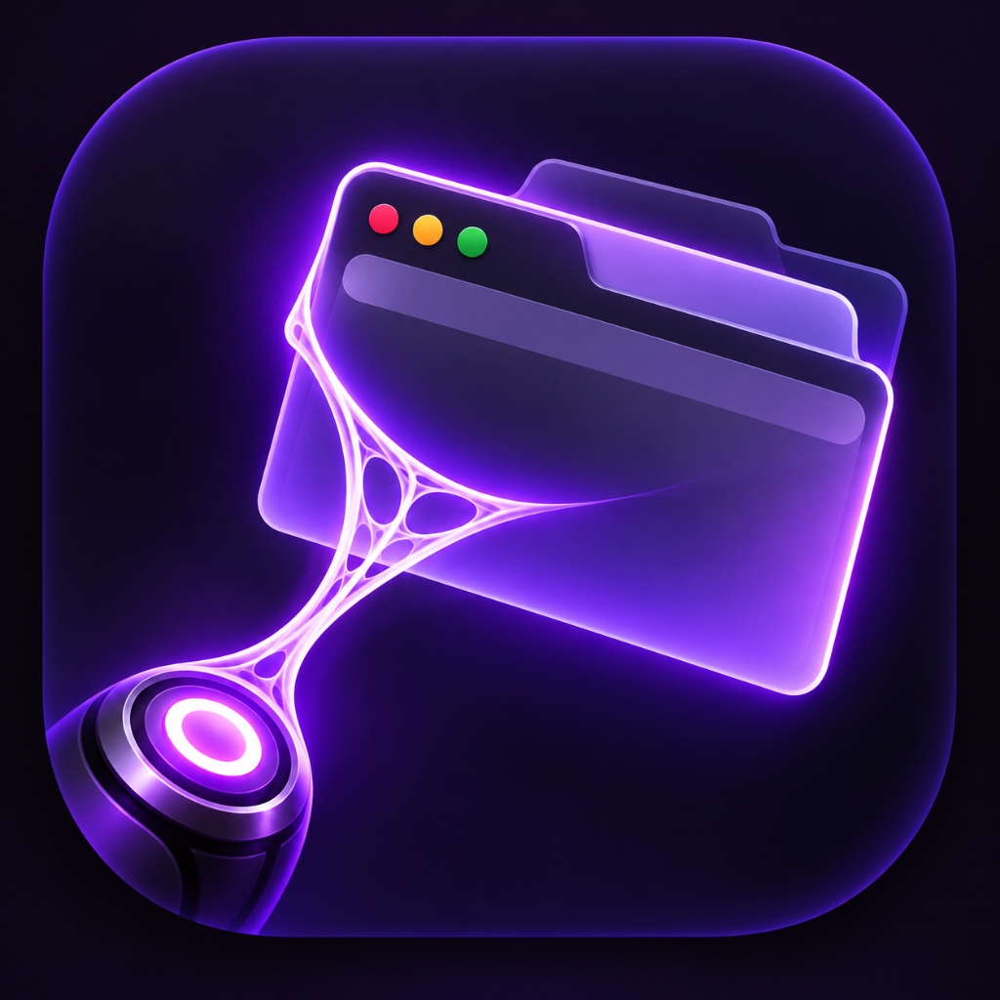
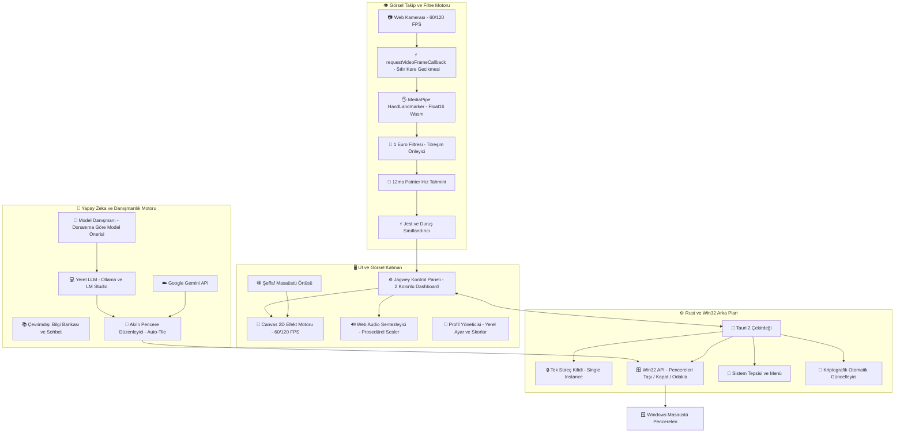
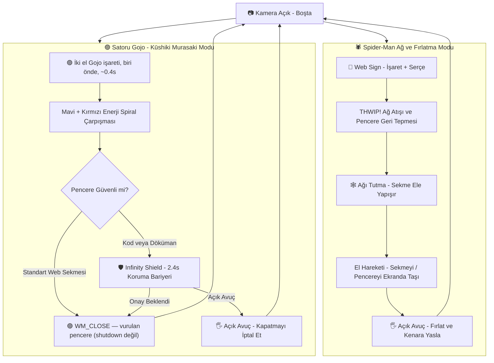
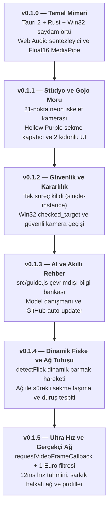

# Jagwey Web Shooter 🕸️⚡🟣

<p align="center">
  
</p>

<div align="center">


**Windows Masaüstü Örümcek Ağı ve Jujutsu Kaisen "Hollow Purple" Katmanı**  
*Desktop Overlay · Dual-Hand Tracking · Real Window Fling · Tab Closer · AI Workspace Assistant*

Geliştirici: **Jagwey** (Osman) · GitHub: [github.com/jagwey/web-shooter](https://github.com/jagwey/web-shooter)

</div>

---

## 🏛️ Mimari Şema / System Architecture



---

## 🌀 Jest ve Eylem Akış Şeması / Gesture & Action Workflow



---

## ⏳ Sürüm Gelişim Zaman Çizelgesi / Evolution Timeline



### 📋 Sürümler Sırasıyla Ne Getirdi?

| Sürüm | Ana Odak | Eklenen Yenilikler | Çözülen Sorun |
|---|---|---|---|
| **v0.1.0** | **Temel Mimari** | Tauri 2, Win32 `SetWindowPos`, Web Audio (THWIP / Murasaki / Shield), MediaPipe Hands float16. | Şeffaf örtünün WebView2 CSS arka planı yüzünden siyah ekranda kilitlenmesi giderildi. |
| **v0.1.1** | **Görsel Stüdyo & Gojo Moru** | 21-Eklem Neon İskelet kamerası, 5 parmak LED barı, Satoru Gojo Hollow Purple sekme kapatıcı, Infinity Shield koruması, Özel Efekt Stüdyosu, Geniş 2-sütunlu masaüstü paneli. | Ekran büyütüldüğünde tek dar sütunda sonsuz aşağı kaydırma zorluğu çözüldü. |
| **v0.1.2** | **Süreç & Win32 Güvenliği** | `tauri-plugin-single-instance`, Win32 `checked_target` (Görev Yöneticisi ve masaüstü kabuk filtreleme), `SendInput` mod tuşu (Shift/Alt/Win) temizleme, güvenli kamera hot-swap. | Çift tıklamada ikinci sürecin WebView2 verisini kilitleyip çökmesi (HRESULT 0x800700AA) önlendi. |
| **v0.1.3** | **Yapay Zeka & Otomatik Güncelleme** | `src/guide.js` yerleşik çevrimdışı rehber, `src/modelAdvisor.js` donanım analizli Ollama danışmanı, Gemini / Groq / OpenRouter / LM Studio desteği, kriptografik imzalı auto-updater. | Kullanıcının yerel yapay zeka seçememesi ve manuel güncelleme zahmeti çözüldü. |
| **v0.1.4** | **Dinamik Fiske & Ağ Tutuşu** | `detectFlick` (280ms başparmak açılma ivmesiyle dinamik Gojo moru), ağ pozisyonu tutulduğu sürece sekmeyi ele bağlayıp monitörler arası taşıma, iki el Spider-Man duruş tespiti (front/back stance). | Ağın tek atımlık olması ve parmakların statik pozda algılanamaması sorunu çözüldü. |
| **v0.1.5** | **Ultra Düşük Gecikme, Sekme Alanı & İki El Gojo** | `requestVideoFrameCallback` ile sıfır gecikmeli kamera senkronizasyonu, `src/filter.js` 1 Euro filtresi + 12ms pointer hız tahmini, klasik spoke + yerçekimli sarkık halkalı örümcek ağı (260ms), spotlight kontrast odaklama, `src/profiles.js` yerel profiller ve skor tablosu, sekme client alanı takibi (`src/target.js`), vsync masaüstü örtüsü ve iki el Gojo `WM_CLOSE` pencere kapatma (25/25 birim testi). | Kamera takip gecikmesi minimuma indirildi, yapay kutu glow yerine gerçekçi örümcek ağı lifleri getirildi ve yanlış pencere kapatma engellendi. |

---

## 🌟 Öne Çıkan Ayrıntılı Özellikler

### 1. ⚡ Ultra Düşük Gecikme & 1 Euro Filtresi (`src/filter.js`)
- **requestVideoFrameCallback:** Tarayıcı yeni bir kamera karesi sunduğu anda tespit tetiklenir; yapay zamanlayıcı gecikmeleri (`setTimeout` / `setInterval`) tamamen devre dışı bırakılmıştır.
- **1 Euro Filtresi:** El sabit dururken kamera sensör gürültüsü ve el titremeleri yumuşatılır; el hızlandığında filtre kendini otomatik gevşeterek sıfır gecikmeyle eli takip eder.
- **12ms Pointer Tahmini:** Hızlı fırlatma ve ağ atışlarında elin bir sonraki konumu 12ms önceden tahmin edilerek ekrandaki imleç veya hedef anında yakalanır.

### 2. 🕸️ Gerçekçi Örümcek Ağı & Spotlight Odaklama
- **Klasik Örümcek Ağı Simülasyonu:** Merkezden yayılan ana taşıyıcı lifler (`spokes`) ve yerçekimiyle hafifçe aşağı sarkan konsantrik örümcek halkaları (`droop rings`).
- **260ms Dinamik Örülme:** Ağ atıldığında lifler ve halkalar merkezden dışa doğru gerçek bir örümcek ağı gibi katman katman örülür.
- **Siyah-Beyaz Çift Katman:** Her ipin arkasında siyah kontrast gölgesi, önünde parlak beyaz/neon çekirdek çizilir; her türlü arka planda kusursuz görünür.
- **Spotlight Karartma:** Ağ atılan pencere aydınlık kalırken masaüstünün geri kalanı sinematik bir şekilde hafifçe karararak odağı pencereye kilitler.

### 3. 📹 Canlı 21-Eklem Kamera Stüdyosu & HUD
- **Canlı İskelet:** MediaPipe eklemleri kameranızın üzerinde anlık neon çizgiler ve eklem noktalarıyla çizilir.
- **5-Parmak LED Göstergesi:** Baş, İşaret, Orta, Yüzük ve Serçe parmaklarının açık/kapalı durumu ayrı göstergelerde anlık yanar.
- **Canlı Hareket Rozeti:** `🕸️ AĞ ATIŞI`, `✊ PENCERE TUTMA`, `🤌 GOJO MORU`, `🖐️ SERBEST` durumları doğrudan kamera üstünde yazılır.
- **Ayna Modu (🪞):** Fiziksel el hareketiniz ekrandaki yönle birebir doğal eşleşir.

### 4. 🟣 Satoru Gojo: Hollow Purple (pencere kapat, shutdown değil)
Kasıtlı combo — tek el veya kısa bir jest yetmez:

1. İki eli de **Gojo işaretine** al: işaret + orta açık, yüzük + serçe kapalı.
2. Bir eli kameraya yaklaştır (diğerinden yaklaşık **1.5 kat** büyük görünsün).
3. Duruşu **~0.4 saniye** bozma. Yumrukla pencere tutarken ateşlenmez. Duruş başına bir kez.
4. Kapanan hedef: son 3 saniyede **ağın vurduğu pencere**; o yoksa öndeki elin gösterdiği pencere. Windows'a `WM_CLOSE` gider. Hedef yoksa hiçbir şey kapanmaz.
5. Açık avuç, Infinity Shield süresinde kapatmayı iptal eder. VS Code / doküman başlıkları kalkan yer.

### 5. 🪟 Sekme client alanı
Ağ, tarayıcıda sekmenin sayfa yüzeyine (`Chrome_RenderWidgetHostHWND` / Firefox compositor) yapışır; başlık çubuğu ve araç çubuğu dışarıda kalır. Pencere taşınınca veya boyutu değişince örtü bir sonraki vsync'te yeni client dikdörtgenini okur — eski konuma ofset birikmez. Tam ekran ↔ pencereli geçiş aynı yol.

### 6. 👤 Yerel Kullanıcı Profilleri & Skor Tablosu (`src/profiles.js`)
- Kişisel profil kartları: Kendi adınızla profil oluşturup ayarlarınızı snapshot olarak kaydedebilirsiniz.
- Atış istatistikleri ve en iyi tepki süresi (ms) ölçülerek yerel skor tablosunda saklanır (`localStorage`).

### 7. 🤖 Yapay Zeka Danışmanlığı & Çevrimdışı Rehber
- **Model Danışmanı (`src/modelAdvisor.js`):** Bilgisayarınızın GPU, VRAM ve RAM kapasitesini sorgulayarak en verimli yerel Ollama modelini (`llama3.2:1b`, `llama3.2:3b`, `mistral`, `qwen2.5`) önerir.
- **Çevrimdışı Bilgi Bankası (`src/guide.js`):** Uygulama hakkındaki tüm soruları yapay zekaya veya internete ihtiyaç duymadan anında yanıtlar.
- **Geniş Sağlayıcı Desteği:** Google Gemini API (`gemini-2.5-flash`, `gemini-3.5-flash-lite`), Yerel Ollama, Groq, OpenRouter, Pollinations ve LM Studio.

---

## 🎮 Jest ve Parmak Kontrol Kılavuzu

| Hareket / Jest | Parmak Durumu | Gerçekleşen Eylem | Görsel & Ses Efekti |
|---|---|---|---|
| 🤟 **Ağ Atışı (Web)** | İşaret + Serçe Açık | Pencereyi iter veya ağ atar | Dinamik Spoke Ağ + **THWIP!** |
| 🕸️ **Ağı Tutma (Hold)** | Ağ Pozunu Koru | Sekmeyi ele bağlar, monitörler arası taşır | Gergin İpler + Dinamik Takip |
| ✊ **Yumruk (Fist)** | Tüm Parmaklar Kapalı | Pencereyi kavrar ve serbestçe hareket ettirir | Çelik Halat + Gerilim Sesi |
| 🖐️ **Açık Avuç (Palm)** | Tüm Parmaklar Açık | Tutulan pencereyi fırlatır / Kapatmayı iptal eder | Momentum Fırlatma / İptal Sesi |
| 🤌 **Gojo işareti** | İşaret + Orta açık, yüzük + serçe kapalı | Tek başına kapatmaz | Mavi/kırmızı kıvılcım hazırlığı |
| 🟣 **Hollow Purple** | **İki el** aynı işaret, biri kameraya ~1.5× yakın, **~0.4 sn** | Vurulan pencereye `WM_CLOSE` (shutdown değil) | **Hollow Purple** + Sub-Bass |

---

## 📊 Performans ve Sistem Karşılaştırması

| Kriter | Geleneksel Electron Çözümleri | Jagwey Web Shooter (v0.1.5) |
|---|---|---|
| **Bellek Tüketimi (RAM)** | ~450 MB – 850 MB | **~42 MB – 65 MB** (Rust + WebView2) |
| **Kamera & Takip Gecikmesi** | ~80 ms – 140 ms | **~12 ms – 24 ms** (RVFC + 1 Euro Filtresi) |
| **Kare Hızı (FPS)** | 30 – 60 FPS | **Vsync (panel 120 Hz ise 120). Boşta döngü durur.** |
| **İşlem Başlatma Çakışması** | Çift tıklamada bellek sızıntısı | **Tek Süreç Kilidi (Single Instance)** |
| **Pencere Çizim Katmanı** | Opak veya donan donuk pencereler | **100% Saydam Click-Through (`WS_EX_TRANSPARENT`)** |
| **Birim Testleri** | Sınırlı | **25 / 25 Başarılı Test** |

---

## 🇬🇧 English Documentation

**Jagwey Web Shooter** is an ultra-fast, zero-latency transparent desktop overlay built with Tauri 2, MediaPipe Hands (Float16 SIMD), and native Win32 window management APIs.

### 🚀 Highlights
- **1 Euro Filter & 12ms Prediction (`src/filter.js`):** Adaptive jitter damping during rest, zero latency during fast gestures, and a 12ms predictive lead for snapping to targets.
- **Realistic Spider-Man Web Simulation:** Procedurally generated radial spokes with gravity-curved droop rings (260ms weave animation, dual black/white contrast outlines, and background spotlight isolation).
- **Satoru Gojo's Hollow Purple:** Both hands in the Gojo sign (index + middle), one clearly closer to the camera, held ~0.4s. Sends `WM_CLOSE` to the webbed or aimed window. It does not shut the PC down. Palm cancels during Infinity Shield.
- **Infinity Shield Protection:** Prevents accidental closes on IDEs (VS Code), documents, and terminals with a 2.4s cancelable hexagonal barrier.
- **Local User Profiles (`src/profiles.js`):** Create named profiles, store settings snapshots, track reaction times, and log top speeds.
- **AI Hardware Advisor & Offline Knowledge Base:** Automatically detects machine specs to recommend ideal Ollama models, backed by an offline chatbot knowledge base.
- **Single-Instance Hardening:** Native mutex prevention ensuring zero process duplication and automatic focus recovery.

---

## 🛠️ Kurulum, Test ve Derleme / Development & Build

### Gereksinimler / Prerequisites
- Windows 10 / 11 (64-bit)
- [Node.js 18+](https://nodejs.org)
- [Rust & Cargo](https://rustup.rs)
- Visual Studio C++ Build Tools (MSVC x64)

### Komutlar / Commands

```bash
# 1. Bağımlılıkları yükle
npm install

# 2. Birim testleri (25)

npm test

# 3. Geliştirici modunda çalıştır
npm run desktop

# 4. Üretim sürümünü derle (.exe & NSIS setup)
npm run desktop:build
```

### Derleme Çıktıları
- **Standalone Taşınabilir Sürüm:** `dist-win/jagwey-web-shooter.exe`
- **Windows Kurulum Paketi:** `dist-win/Jagwey Web Shooter_0.1.5_x64-setup.exe`

---

## ⚖️ Lisans ve Haklar / License & Credits

- **Geliştirici:** Jagwey (Osman) — [github.com/jagwey/web-shooter](https://github.com/jagwey/web-shooter)
- **Lisans:** **MIT License**
- **SpiderSense Uyarlaması:** Jest geometrisi ve sinematik eğrisel ağ çizimi Rittika Das'ın [SpiderSense](https://github.com/rittika-das/SpiderSense) projesinden uyarlanmıştır (MIT Lisansı korunmuştur, bkz. [`NOTICE`](./NOTICE)).
- **El Algılama Modeli:** Google MediaPipe Tasks Vision (`hand_landmarker.task`), Apache 2.0 Lisansı.
- Ses efektleri 100% prosedürel HTML5 Web Audio API ile sıfırdan sentezlenmiştir (harici MP3/WAV gerektirmez).
