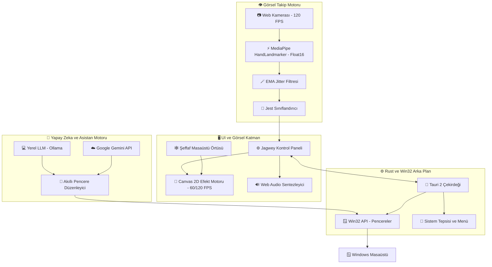
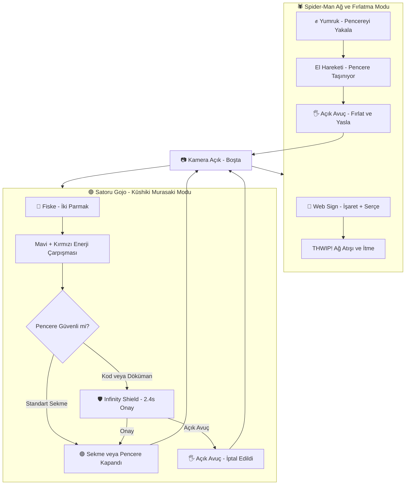

# Jagwey Web Shooter 🕸️⚡🟣

<p align="center">
  
</p>

<div align="center">


**Windows Masaüstü Örümcek Ağı ve Jujutsu Kaisen "Hollow Purple" Katmanı**  
*Desktop Overlay · Dual-Hand Tracking · Real Window Fling · Tab Closer · AI Workspace Assistant*

Geliştirici: **Jagwey** (Osman) · GitHub: [github.com/jagwey/web-shooter](https://github.com/jagwey/web-shooter)

</div>

---

## 🏛️ Mimari Şema / System Architecture



---

## 🌀 Jest ve Eylem Akış Şeması / Gesture & Action Workflow



---

## 🇹🇷 Türkçe Açıklama ve Özellikler

**Jagwey Web Shooter**, ekranınızın üzerinde tamamen şeffaf ve tıklamaları geçiren (`WS_EX_TRANSPARENT`) bir katman oluşturarak web kamerası aracılığıyla ellerinizi takip eden fütüristik bir masaüstü aracıdır.

### 🌟 Yeni Eklenen Efsanevi Özellikler

#### 1. 🖥️ Geniş 2 Sütunlu Dashboard ve Tam Ekran Desteği
- **Sıfır Kaydırma Konforu:** Dar mobil düzen yerine sol tarafta sabit canlı kamera, sağ tarafta tüm ayar kartları yerleştirildi. Dikey kaydırma ihtiyacı minimuma indirildi.
- **⛶ Tam Ekran Butonu:** Tek tıkla tam ekran moduna geçip çıkabilirsiniz.
- **Pencereli / Geniş Varsayılan Mod:** Masaüstünde rahat ve ferah bir kontrol deneyimi sunar.

#### 2. 🪟 %100 Kusursuz Şeffaf Örtü (Sıfır Siyah Ekran)
- **Tamamen Şeffaf:** Masaüstü örtüsünün arka planı WebView2 motorunda pürüzsüz şeffaf katman (`rgba(0,0,0,0)`) olarak optimize edildi. Ekran asla kararmaz.
- **Tıklamaları Geçiren Mimari:** Örtü açıkken pencerelerinizdeki yazılara, linklere ve butonlara normal bir şekilde tıklamaya devam edebilirsiniz (`WS_EX_TRANSPARENT`).

#### 3. 📹 Canlı Kamera ve El Test Stüdyosu (Geniş HD Test Alanı)
- **Canlı 21-Eklem Neon İskelet Çizimi:** MediaPipe eklemleri kameranızın üzerinde anlık olarak parlak neon çizgiler ve eklem noktalarıyla çizilir; elinizin tam olarak nerede ve nasıl algılandığını canlı görün.
- **Anlık Jest Rozeti (Live HUD):** Algılanan hareket anında animasyonlu rozette (`🕸️ Ağ Atışı`, `✊ Pencere Tutma`, `🖐️ Açık Avuç`, `🤌 Gojo Moru`) gösterilir.
- **5-Parmak Durum Göstergesi:** Baş, İşaret, Orta, Yüzük ve Serçe parmaklarınızın açık/kapalı durumu 5 ayrı neon kapsülde anlık yanar.
- **🪞 Ayna Modu (Mirror Mode) ve 🔍 Büyüt/Küçült:** Tek tıkla kamerayı ayna gibi yatay çevirin veya tam ekran test yapın.

#### 4. 🖐️ Kararlı ve Güvenli El Algılama Motoru
- **Doğrudan Ana Katman (In-Thread):** Web Worker kısıtlamaları aşılarak model doğrudan optimize edilmiş yürütme katmanında çalışır.
- **Yerel + CDN Yedekli Başlatma:** Model önce yerel dosyalardan yüklenmeyi dener; gerekirse resmi CDN üzerinden otomatik fallback sağlar.
- **GPU + Otomatik CPU Geçişi:** WebGL başlatılamazsa donma yapmadan CPU moduna geçerek el takibini kesintisiz sürdürür.

#### 5. ✨ Kendi Efektini Yarat (Custom FX Studio)
- **Tam Kişiselleştirme:**
  - 🎨 **Ağ Rengi**: İpin merkez rengini renk paletinden seçin.
  - 🔮 **Aura Parlaması**: Dış ışıma ve neon parlama rengi.
  - 🌟 **Parçacık Rengi**: Kıvılcım ve yıldızların rengi.
  - 💫 **Parçacık Stilleri:** `⚡ Elektrik / Kıvılcım`, `✨ Yıldız Tozu`, `🕸️ Klasik Ağ`, `🌸 Kiraz Çiçeği`, `🔥 Alev Korları`, `💜 Gojo Boşluk Küreleri`.
  - 📏 **Ağ Kalınlığı**: 1px'ten 8px'e kadar serbest kalınlık ve sıklık ayarı.
  - 🎯 **Prova Atışı ve Kaydet:** Efektinizi anında test edip kaydedin.

#### 6. 🔀 Özellikler ve Hibrit Mod
- Bütün özellikleri aynı anda kullanabilirsiniz:
  - `[x] 🕸️ Ağ İpleri ve Parçacıklar`: Dinamik lifler ve parçacık efektleri.
  - `[x] 🎯 Hedef Pencere Çerçevesi`: Seçilen pencerenin etrafına yüksek kontrastlı neon odak kutusu.
  - `[x] ⚡ Çift El Bağımsız Kontrol`: Bir elinizle pencere taşırken diğer elinizle ağ atabilir veya sekme kapatabilirsiniz.

#### 7. 🟣 Satoru Gojo: Kūshiki "Murasaki" (Hollow Purple) ve Sekme Kapatıcı
- **İki Parmak / Fiske Hareketi:** İşaret ve orta parmağınızı birlikte uzattığınızda veya fiske yaptığınızda Gojo Satoru'nun ikonik tekniği tetiklenir.
- **Sinematik Görsel:** Mavi (Lapse) ve Kırmızı (Reversal) küreler spiral çizerek çarpışır ve parlayan **Hollow Purple** küresine dönüşerek enerji dalgası fırlatır.
- **Gerçekçi Ses:** Prosedürel sub-bass şok dalgası ve uzay enerjisi sentezi.
- **Hedef Kapatma:** İmlecin altındaki açık internet sekmesini (`Ctrl+W`) veya tüm pencereyi (`WM_CLOSE`) kapatır.
- **🛡️ Infinity Shield:** Kodlama ortamları (VS Code) veya form sayfalarında kazara kapatmayı önlemek için altın-mavi altıgen bariyer devreye girer (2.4s içinde açık avuç ile iptal edilebilir).

#### 8. 🤖 Jagwey AI Asistanı ve İnteraktif Tanı Merkezi
- **👋 Merhaba ve Çalışıyor musun? (Sağlık Testi):** Tek tıkla AI tanı sistemine çağrı gönderir; sistem gecikmesini (ms), 120 FPS durumunu ve donanım sağlığını raporlar.
- **⚡ Akıllı 1-Tıkla Optimize Et:** Ekran çözünürlüğü ve GPU durumunuza göre en ideal ayarları uygular.
- **🗂️ Akıllı Pencereleri Düzenle (Auto-Tile):** Masaüstündeki pencereleri altın oranla ekrana hizalar.
- **Sağlayıcı Seçenekleri:** Yerel Kural Tabanlı Motor (Sıfır kurulum), Ollama (`llama3.2`, `mistral`) ve Google Gemini API (`gemini-2.5-flash`).

#### 9. 🔒 %100 Çevrimdışı ve Sıfır Telemetri
- Kamera görüntünüz ve hiçbir veriniz bilgisayarınızdan dışarı çıkmaz, sunucuya gönderilmez.
- Kaynak kodlar tamamen açıktır ve denetime uygundur.

---

## 🎮 Jest Tablosu / Gesture Control Guide

| Hareket / Gesture | Parmak Durumu | İşlev / Action | Efekt |
|---|---|---|---|
| 🤟 **Ağ Atışı (Web)** | İşaret + Serçe Açık, Diğerleri Kapalı | Gerçek pencereyi geri teptirir | Sinematik Ağ + **THWIP!** |
| ✊ **Yumruk (Fist)** | Tüm Parmaklar Kapalı | Pencereyi kavrar ve elinize bağlar | Gergin Halat + Çınlama |
| 🖐️ **Açık Avuç (Palm)** | Tüm Parmaklar Açık | Tutulan pencereyi fırlatır / İptal eder | Momentum Fırlatma / İptal |
| 🟣 **Gojo Fiske (Flick)** | İşaret + Orta Parmak Birlikte / Fiske | Aktif sekmeyi veya pencereyi kapatır | **Hollow Purple** + Sub-Bass Patlaması |
| ☝️ **İşaret (Point)** | Yalnızca İşaret Parmağı Açık | Serbest Atanabilir Özel Kısayol | Özel Atama |

---

## 🇬🇧 English Documentation

**Jagwey Web Shooter** is a zero-latency, transparent desktop overlay built with Tauri 2, MediaPipe Hands (Float16 SIMD), and native Win32 window management APIs.

### 🚀 Highlights
- **Satoru Gojo's Hollow Purple (Kūshiki: Murasaki):** Use the two-finger flick gesture to obliterate active tabs (`Ctrl+W`) or windows (`WM_CLOSE`) with an authentic Blue + Red fusion animation and explosive sub-bass synth sound.
- **Infinity Shield Protection:** Prevents accidental closes on IDEs (VS Code), documents, or uncommitted work with a 2.4s cancelable hexagonal barrier.
- **AI Workspace Assistant:** Connect local Ollama (`llama3.2`) or Google Gemini (`gemini-2.5-flash`) to intelligently auto-tile and organize open windows on your desktop.
- **Dual-Hand Tracking:** Track both hands simultaneously at up to 120 FPS with real-time exponential smoothing for jitter-free tracking.
- **Ultra Lightweight:** Uses only **~42 MB RAM** (native Rust + WebView2). Camera turns off cleanly when idle or minimized.

---

## 🛠️ Kurulum ve Derleme / Development & Build

### Gereksinimler / Prerequisites
- Windows 10 / 11 (64-bit)
- [Node.js 18+](https://nodejs.org)
- [Rust & Cargo](https://rustup.rs)
- Visual Studio C++ Build Tools (MSVC x64)

### Komutlar / Commands

```bash
# 1. Bağımlılıkları yükle
npm install

# 2. Birim testlerini çalıştır (10/10 test)
npm test

# 3. Geliştirici modunda çalıştır
npm run desktop

# 4. Üretim sürümünü derle (.exe & NSIS setup)
npm run desktop:build
```

### Derleme Çıktıları
- **Standalone Portable Exe:** `dist-win/jagwey-web-shooter.exe`
- **NSIS Windows Installer:** `dist-win/Jagwey Web Shooter_0.1.0_x64-setup.exe`

---

## ⚖️ Lisans ve Haklar / License & Credits

- **Geliştirici:** Jagwey (Osman) — [github.com/jagwey/web-shooter](https://github.com/jagwey/web-shooter)
- **Lisans:** **MIT License**
- **SpiderSense Uyarlaması:** Jest geometrisi ve sinematik eğrisel ağ çizimi Rittika Das'ın [SpiderSense](https://github.com/rittika-das/SpiderSense) projesinden uyarlanmıştır (MIT Lisansı korunmuştur, bkz. [`NOTICE`](./NOTICE)).
- **El Modeli:** Google MediaPipe Tasks Vision (`hand_landmarker.task`), Apache 2.0 Lisansı.
- Ses efektleri 100% prosedürel HTML5 Web Audio API ile sıfırdan sentezlenmiştir (harici dosya gerektirmez).
