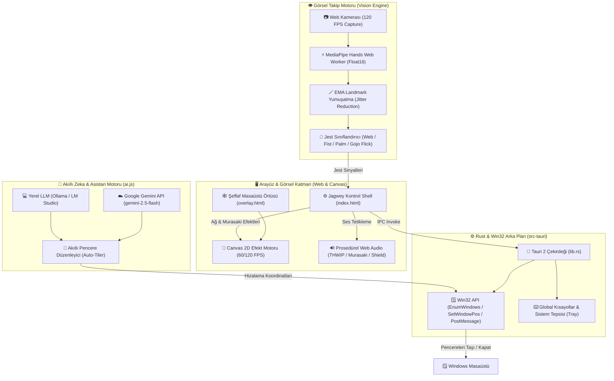
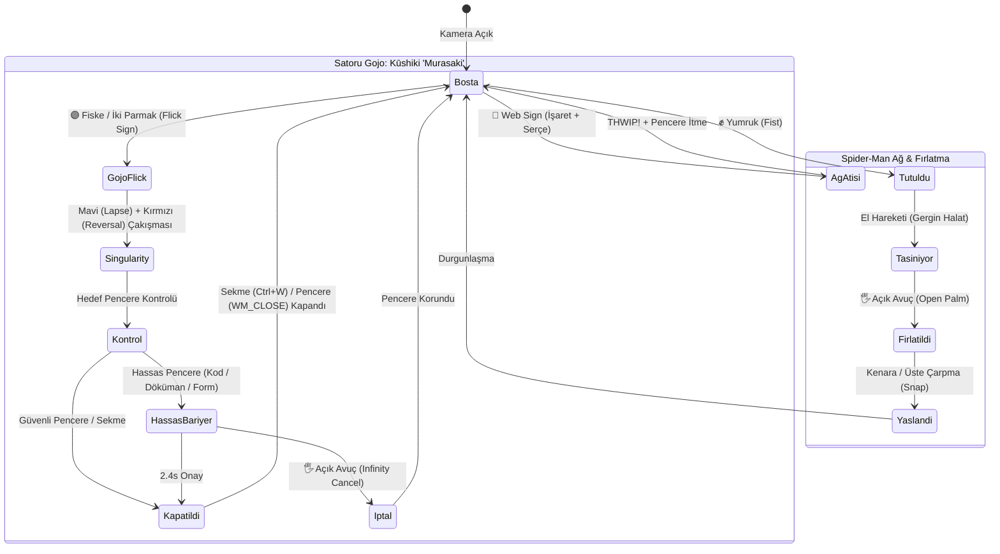

# Jagwey Web Shooter 🕸️⚡🟣

<div align="center">


**Windows Masaüstü Örümcek Ağı & Jujutsu Kaisen "Hollow Purple" Katmanı**  
*Desktop Overlay · Dual-Hand Tracking · Real Window Fling · Tab Closer · AI Workspace Assistant*

Geliştirici: **Jagwey** (Osman) · GitHub: [github.com/jagwey/web-shooter](https://github.com/jagwey/web-shooter)

</div>

---

## 🏛️ Mimari Şema / System Architecture



---

## 🌀 Jest & Eylem Akış Şeması / Gesture State Machine



---

## 🇹🇷 Türkçe Açıklama ve Özellikler

**Jagwey Web Shooter**, ekranınızın üzerinde tamamen şeffaf ve tıklamaları geçiren (`WS_EX_TRANSPARENT`) bir katman oluşturarak webcam aracılığıyla ellerinizi takip eden fütüristik bir masaüstü aracıdır.

### 🌟 Yeni Eklenen Efsanevi Özellikler

#### 1. 🟣 Satoru Gojo: Kūshiki "Murasaki" (Hollow Purple) & Sekme Kapatıcı
- **İki Parmak / Fiske Hareketi:** İşaret ve orta parmağınızı birlikte uzattığınızda veya fiske yaptığınızda Gojo Satoru'nun ikonik Kūshiki "Murasaki" tekniği tetiklenir!
- **Sinematik Görsel Şölen:** Mavi (Lapse) ve Kırmızı (Reversal) küreler elinizin etrafında spiral çizerek döner, ardından merkezde çarpışarak karanlık bir çekirdeğe sahip parlayan **Hollow Purple** küresine dönüşür ve devasa bir enerji dalgası fırlatır!
- **Gerçekçi Ses Efekti:** Düşük frekanslı sub-bass şok dalgası ve yüksek rezonanslı uzay enerjisi sentezi.
- **Hedef Kapatma:** İmlecin altındaki açık internet sekmesini (`Ctrl+W`) veya tüm pencereyi (`WM_CLOSE`) anında kapatır.
- **🛡️ Infinity Shield (Hassas Pencere Koruması):** Kodlama ortamları (VS Code, Visual Studio), dökümanlar (Google Docs, Sheets, Word) veya form sayfalarında kazara sekme kapatmayı önlemek için altın-mavi altıgen **Infinity Bariyeri** devreye girer. Kullanıcı 2.4 saniye içinde açık avuç (`palm`) yaparak kapatmayı iptal edebilir!

#### 2. 🤖 Yapay Zeka Masaüstü Asistanı (AI Workspace Assistant)
- **Sağlayıcı Desteği:**
  - ☁️ **Google Gemini API:** `gemini-2.5-flash` veya `gemini-1.5-flash` model desteği (kullanıcı kendi API Key'ini girebilir).
  - 💻 **Yerel Ollama / LM Studio:** Tamamen yerel, internetsiz ve gizli (`http://localhost:11434`, `llama3.2`, `qwen2.5` vb.).
  - 🌐 **Özel OpenAI Uyumlu API.**
- **Akıllı Düzenle (Auto-Tile):** "Pencereleri Akıllı Düzenle" butonuna tıklandığında açık masaüstü pencereleri taranır ve yapay zeka tarafından ana pencere + sağ yığın olarak altın oranda ekrana muntazam şekilde hizalanır.

#### 3. 🎯 Gelişmiş El Takibi & EMA Yumuşatma (Jitter-Free)
- MediaPipe 21 eklem noktası üzerinde çalışan **Üstel Hareketli Ortalama (EMA)** filtresi sayesinde kamera gürültüsü ve titremeler tamamen filtrelenir.
- Jest geçişleri daha kararlı, yumruk ve atış hissi kaya gibi stabildir.

#### 4. 🌸 Soft, Estetik & Kullanıcı Dostu Temalar
Herkesin (kızlar, erkekler, minimalistler) severek kullanacağı yumuşak ve göz alıcı renk seçenekleri:
- 🌸 **Sakura Pastel:** Gül pembesi, sıcak altın ve süt beyazı ferahlatıcı tonlar.
- 🤍 **Clean Snow:** Modern, sade, dikkat dağıtmayan gökyüzü mavisi ve beyaz çizgiler.
- 🌙 **Midnight Cyber:** Koyu estetik okyanus gecesi ve neon turkuaz parıltı.
- 🌿 **Soft Sage & Mint:** Rahatlatıcı adaçayı, okaliptüs yeşili ve krem rengi.
- 🕷️ **Süper Kahraman Serisi:** Classic Spider-Man, Miles Morales, Symbiote Venom ve Gojo Satoru Moru.

#### 5. 🎯 Sade Çerçeveleme Modu (Minimal Focus Frame)
- Ağ ve fırlatma efektlerini fazla hareketli bulan veya ofis ortamında sade çalışmak isteyenler için:
- Seçilen veya tutulan pencerenin etrafında **yüksek kontrastlı, neon köşeli zarif bir odak çerçevesi** ve pencere başlık kartı belirir.
- Sıfır göz yorulması, şık macOS Stage Manager / Figma seçim kutusu hissiyatı.

#### 6. 🔒 %100 Çevrimdışı & Açık Kaynak Güvencesi
- **Sıfır Sunucu & Sıfır Veri Toplama:** Kamera görüntünüz veya el veriniz kesinlikle internete çıkmaz. Tüm işlem yerel bilgisayarınızda (MediaPipe WebAssembly) çalışır.
- **Açık ve Şeffaf Kod:** Uygulamanın tüm kaynak kodlarını dilediğiniz yapay zekaya (ChatGPT, Claude, Gemini) okutarak güvenlik ve gizlilik denetimini kendiniz teyit edebilirsiniz.

#### 7. 📱 Telefon Kamerasını Bağlama & Çoklu Monitör Hub
- DroidCam veya Iriun Webcam ile telefonunuzu kablosuz (Wi-Fi) veya USB ile bağlayıp 1080p 60/120 FPS el takibi yapabilirsiniz.
- Çoklu monitör desteğiyle örtüyü ana ekrana, yan ekrana verebilir veya tüm ekranlara yayabilirsiniz.

---

## 🎮 Jest Tablosu / Gesture Control Guide

| Hareket / Gesture | Parmak Durumu | İşlev / Action | Efekt |
|-------------------|---------------|----------------|-------|
| 🤟 **Ağ Atışı (Web)** | İşaret + Serçe Açık, Diğerleri Kapalı | Gerçek pencereyi geri teptirir | Sinematik Ağ + **THWIP!** |
| ✊ **Yumruk (Fist)** | Tüm Parmaklar Kapalı | Pencereyi kavrar ve elinize bağlar | Gergin Halat + Çınlama |
| 🖐️ **Açık Avuç (Palm)** | Tüm Parmaklar Açık | Tutulan pencereyi fırlatır / İptal eder | Momentum Fırlatma / İptal |
| 🟣 **Gojo Fiske (Flick)** | İşaret + Orta Parmak Birlikte / Fiske | Aktif sekmeyi veya pencereyi kapatır | **Hollow Purple** + Sub-Bass Patlaması |
| ☝️ **İşaret (Point)** | Yalnızca İşaret Parmağı Açık | Serbest Atanabilir Özel Kısayol | Özel Atama |

---

## 🇬🇧 English Documentation

**Jagwey Web Shooter** is a zero-latency, transparent desktop overlay built with Tauri 2, MediaPipe Hands (Float16 SIMD Worker), and native Win32 window management APIs.

### 🚀 Highlights
- **Satoru Gojo's Hollow Purple (Kūshiki: Murasaki):** Use the two-finger flick gesture to obliterate active tabs (`Ctrl+W`) or windows (`WM_CLOSE`) with an authentic Blue (Convergence) + Red (Divergence) fusion animation and explosive sub-bass synth sound.
- **Infinity Shield Protection:** Prevents accidental closes on IDEs (VS Code), docs (Google Docs/Sheets), or uncommitted work with a 2.4s cancelable hexagonal barrier.
- **AI Workspace Assistant:** Connect local Ollama (`llama3.2`) or Google Gemini (`gemini-2.5-flash`) to intelligently auto-tile and organize open windows on your desktop.
- **Dual-Hand Tracking:** Track both hands at up to 120 FPS with real-time exponential smoothing for jitter-free tracking.
- **Ultra Lightweight:** Uses only **~42 MB RAM** (native Rust + WebView2, not bloated Electron). Camera turns off cleanly when idle or minimized.

---

## 🛠️ Kurulum & Derleme / Development & Build

### Gereksinimler / Prerequisites
- Windows 10 / 11 (64-bit)
- [Node.js 18+](https://nodejs.org)
- [Rust & Cargo](https://rustup.rs)
- Visual Studio C++ Build Tools (MSVC x64)

### Komutlar / Commands

```bash
# 1. Bağımlılıkları yükle
npm install

# 2. Birim testlerini çalıştır (10/10 test)
npm test

# 3. Geliştirici modunda çalıştır
npm run desktop

# 4. Üretim sürümünü derle (.exe & NSIS setup)
npm run desktop:build
```

Derlenen kurulum dosyaları `dist-win/` dizininde üretilir:
- `dist-win/jagwey-web-shooter.exe` (Standalone Taşınabilir Sürüm)
- `dist-win/Jagwey Web Shooter_0.1.0_x64-setup.exe` (Windows Kurulum Paketi)

---

## ⚖️ Lisans & Teşekkür / License & Credits

- Geliştirici: **Jagwey** (Osman)
- Lisans: **MIT License**
- Gesture & Web draw mechanics adapted from **SpiderSense** (© 2026 Rittika Das, MIT License).
- Satoru Gojo & Hollow Purple concepts inspired by *Jujutsu Kaisen* (Gege Akutami / MAPPA).
- Ses efektleri 100% prosedürel HTML5 Web Audio API ile sıfırdan sentezlenmiştir (harici MP3/WAV gerektirmez).

# 4. Bağımsız Release Exe ve NSIS Kurucusunu derle
npm run desktop:build
```

> **Not:** Windows OneDrive kilitlenmelerini önlemek amacıyla derleme hedef dizini `src-tauri/.cargo/config.toml` ile otomatik olarak `C:\Users\<Kullanıcı>\.cargo-target\web-shooter` altına yönlendirilmiştir.

### Derleme Çıktıları
- **Standalone Portable Exe:** `dist-win/jagwey-web-shooter.exe`
- **NSIS Windows Installer:** `dist-win/Jagwey Web Shooter_0.1.0_x64-setup.exe`

---

## ⚖️ Lisans ve Haklar / License & Credits

- **Geliştirici:** Jagwey (Osman) — [github.com/jagwey/web-shooter](https://github.com/jagwey/web-shooter)
- **SpiderSense Uyarlaması:** Jest geometrisi ve sinematik eğrisel ağ çizimi Rittika Das'ın [SpiderSense](https://github.com/rittika-das/SpiderSense) projesinden uyarlanmıştır (MIT Lisansı korunmuştur, bkz. [`NOTICE`](./NOTICE)).
- **El Modeli:** Google MediaPipe Tasks Vision (`hand_landmarker.task`), Apache 2.0 Lisansı.
- Instagram üzerindeki ilham verici Spidey makarası yalnızca görsel motivasyon kaynağıdır; kod tabanı orijinal olarak sıfırdan Tauri 2 + Rust + Vanilla JS mimarisinde geliştirilmiştir.
